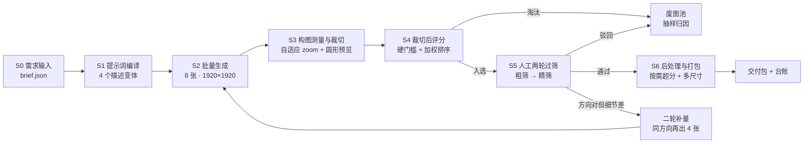

# AI 动漫头像生成方案（评审稿）

| 项目 | 内容 |
|-|-|
| 文档用途 | 方案评审 / 实施基线 / 后续迭代依据 |
| 输入依据 | 《动漫头像挑选与设置指南》（下文简称「验收指南」） |
| 交付形态 | 中文方案文档（本文件，唯一版本） |
| 当前路线 | **只走 Agent 侧生图（E 路线）**；SDXL / Flux / 商业 API / 自训底模仅作升级路径保留（附录 D） |
| 状态 | 方向已定，待评审确认 4 个待决问题（见第 8 节） |
| 范围 | 仅覆盖「用 AI 生成精致好看的动漫头像」的产品化链路，不含社区、付费、运营等业务设计 |

**修订记录**（本文档为唯一版本，后续修改直接原地更新，不再另存版本文件）

| 轮次 | 变更 | 位置 |
|-|-|-|
| 初稿 | 生成路线、质量保障、端到端链路、分期实施 | 全文 |
| 第 2 轮 | 新增生成后端 E（Agent 侧图像生成能力）；用 4 次真实调用做能力边界实测；新增混合编排、相关风险与待决问题 | 2.1 / 2.3 / 4.3 / 5 / 8 / 附录 C |
| 第 3 轮 | 2.1 改为按实现简易度从轻到重排序，并补充排序依据；合并为单一版本文档 | 2.1 / 全文 |
| 第 4 轮 | **主链路切换为纯 E 路线**：其它后端收进附录 D 升级路径；质量保障改为「铺量 + 裁切补偿 + 裁切后评分」；链路删除高清重绘环节；实施计划与风险表按纯 E 重排 | 0 / 2.2 / 2.5 / 2.6 / 3 / 4 / 5 / 6 / 8 / 附录 |

---

## 0. 一页结论

- **当前唯一实施路线：Agent 侧生图（E）**。理由很直接：零部署、零显卡、单图质量已实测达到「可进人工终审」的水平，且产物就是普通图片，可直接接裁切、评分与打包。在硬件与团队投入尚未就位前，它是唯一能立刻产出成品的选择。
- **代价必须明说**：没有 seed、没有参考图、没有 ControlNet，所以**不可复现、构图不可控、无法锁定同一张脸**。这三点不是待解决的 bug，而是这条路的固有约束，只能绕，不能修。
- **绕法就三招**：① 多轮生成铺量（每需求 8 张起，靠数量盖住成品率）；② 生成后裁切补偿构图（实测眼睛位置稳定在 0.40–0.45，必须靠裁切抬到上部 1/3）；③ 裁切后评分 + 硬门槛筛选（构图分不在原图上算，否则会系统性误杀）。
- **一致性口径下调**：当前版本承诺「同一批次的几张看起来像同一角色」，**不承诺「同一角色不变脸」**。需要角色化交付时，走附录 D 的升级路径。
- **SDXL / Flux / 商业 API / 自训底模：当前不做**。不是否决，而是收进附录 D 作为升级路径，并写清触发条件（本地显存/算力到位、需求出现身份一致性、需要可复现或批量 SLA）与届时需补做的验证。
- **分期**：P0 定型生成协议与人工过筛节奏 → P1 自动裁切 + 裁切后评分 + 交付包 → P2 产能与稳定性 → P3 可选（对外或触发升级评估）。

---

## 1. 背景、目标与验收基准

### 1.1 问题定义

头像的真实使用场景是好友列表里一枚极小的圆，因此「精致好看」不等于「画面精美」，而是**缩小后仍然好看**。验收指南已经给出了判断标准，本方案的工程目标就是把这些主观描述变成可测量、可回归的指标。

### 1.2 当前版本的目标（可验收）

输入一份「需求单」（角色描述 + 气质方向 + 目标平台 + 数量），系统输出：

1. 至少 1 张**满足全部硬门槛**的头像主图（1024×1024 master）；
2. 3–6 张同批次备选，**核心特征与气质一致**（发色、瞳色、服装、配饰、情绪方向），脸型允许有差异；
3. 目标平台所需的尺寸包（含圆形裁切预览图）；
4. 一份台账：prompt 原文、生成时间、工具版本、裁切参数、评分明细——**可追溯，但不保证像素级复现**。

当前版本**明确不承诺**：同一角色跨批次不变脸、同一张图可复现、批量交付的时效 SLA。这三项依赖自控后端，见附录 D。

### 1.3 验收基准：从文案到指标

验收指南的表述需要先量化，才能自动化。下表的区间是**首版初值**，必须用标注集标定（见 3.4 与 6.2）。

| 验收指南原文 | 量化指标 | 计算方式 | 硬门槛 |
|-|-|-|-|
| 脸占画面 50%–70% | `face_ratio` | 人脸框面积 ÷ 圆形安全区面积 | 0.45 ≤ x ≤ 0.78 |
| 至少一只眼睛完整可见 | `eye_visible` | 眼部关键点完整 + 遮挡判定 | = 1 |
| 眼睛落在画面上部 1/3 | `eye_center_y` | 主眼中心纵坐标（0=顶，1=底） | 0.12 ≤ y ≤ 0.36 |
| 头顶/肩/手/发饰/耳朵不被切一半 | `edge_margin` | 关键点到圆边最小距离 ÷ 圆半径 | ≥ 0.03，且截断面积 ≤ 15% |
| 下巴与额头在圆内、不贴边 | `chin_forehead_margin` | 下巴/额头顶点到圆边距离 | ≥ 0.05 |
| 背景无文字、杂物、第二人 | `bg_clean` | OCR 文本框数 = 0 且 `face_count` = 1 | 必须满足 |
| 一眼看出情绪 | `emotion_conf` | 情绪四分类（温柔/清冷/俏皮/疏离）top1 置信度、top1−top2 差值 | ≥ 0.60 且 gap ≥ 0.15 |
| 缩小后仍可读（补充） | `thumb_readable` | 缩至 96×96 后人脸检测置信度 | ≥ 0.80 |
| 面部不崩、不发糊（补充） | `face_quality` | 人脸区域锐度 + 美学分 + 五官对称性 | 见 3.4 权重 |

> **所有构图类指标（`face_ratio`、`eye_center_y`、`edge_margin`、`chin_forehead_margin`）一律在裁切后的 1024 图上计算**，不在生成原图上算。原因见 2.3：生成原图的构图系统性不达标，在原图上打分会把整批图误杀。
>
> 「六条自检」是**人工终审清单**，上表是它的自动化近似。自动分负责把 90% 的废图挡在前面，人工负责判断「美不美」这种机器还不可靠的部分。

### 1.4 非目标

- 不做写实真人头像（架构可复用，但风格体系与评分模型不同）。
- 不做视频、动态头像。
- 不做社交/社区功能。
- 不承诺「一次生成即完美」；本方案的核心是**批量生成 + 强筛选**，把好图从大量候选中捞出来。
- 当前版本不做：身份锁定、像素级复现、批量交付时效承诺（见 1.2）。

---

## 2. 生成路线

### 2.1 候选方案对比

下表**按实现简易度从轻到重排序**（排序依据见 2.1.1）。**当前选择第 1 行（E），排序与决策一致**；第 2–5 行不作为当前实施内容，仅作附录 D 的升级路径。

| 排序 | 方案 | 实现简易度（排序依据） | 代表模型/能力 | 动漫画质 | 可控性（姿态/构图/一致性） | 生态成熟度 | 成本结构 | 主要短板 |
|-|-|-|-|-|-|-|-|-|
| 1 | **E. Agent 侧图像生成能力**〔当前选用〕 | ★★★★★ 零配置：不装环境、不备显卡、不需申请，一条 prompt + 尺寸即出图（已实测） | 宿主内置生图工具 / 图像生成插件（如本次实测所用的内置生图工具） | 高：柔和插画 / 轻赛璐璐质感，单图完成度高 | 低：仅自然语言描述；**无 seed、无参考图输入、无 ControlNet、无负向词、无 LoRA** | 无需部署，随宿主的工具版本变化 | 由宿主配额/计费口径决定（待核实） | 不可复现；精确视角与精确属性不可靠；无法做身份控制；批量吞吐与许可待验证 |
| 2 | **C. 商业动漫 API**〔升级备选〕 | ★★★★ 简：注册 + 计费即可出图，但需处理内容审核、配额与 ToS | NovelAI / Midjourney niji / 即梦 / 可灵 等 | 高（开箱即用） | 低：无自定义 LoRA、ControlNet 控制粗、角色一致性弱 | 无需运维，但不可改模型 | 按张/按订阅计费 | 不可控、不可复现、ToS 对商用与二次分发限制多、无法沉淀自有风格资产 |
| 3 | **A. SDXL 二次元微调系**〔升级备选〕 | ★★★ 中：要装 ComfyUI + 模型 + workflow；可先走 serverless 免自建硬件，自建后降为 ★ | Illustrious-XL / NoobAI-XL / Animagine XL 3.x / Pony V6 XL | 高（赛璐璐、平涂、轻小说插画都能覆盖） | 高：ControlNet(OpenPose/Depth/Lineart)、IP-Adapter、InstantID、ADetailer、海量风格 LoRA | 最高 | 自建 GPU 或 serverless 按秒 | 解剖结构弱于 Flux，手部易崩；部分基座训练数据来源与商用许可需逐一核对 |
| 4 | **B. Flux.1 系**〔升级备选〕 | ★★ 较重：在 A 的部署之上还需更高显存（dev 约 24GB 级）与独立的参数、提示词适配 | Flux.1-dev（非商用许可）/ Flux.1-schnell（Apache-2.0） | 中高：写实与半写实强，纯赛璐璐质感需专门 LoRA | 中高：ControlNet（Union/Canny/Depth）、Redux 参考图、PuLID/InstantID 变体 | 较成熟，工具链更新快 | 显存与算力需求更高（dev 约 24GB 级） | 原生二次元风格偏弱；dev 商用受限；LoRA 生态数量不及 SDXL |
| 5 | **D. 自训底模**〔暂不考虑〕 | ★ 最重：需自有数据、算力与调参能力，从零到可用周期最长 | 在 A 或 B 上继续预训练 | 上限最高 | 最高 | 低 | 高（数据 + 算力 + 调参） | 投入产出比在早期不成立 |

#### 2.1.1 排序依据（为什么是这个顺序）

四个判据，逐条打分后取综合，简单者排前：

| 判据 | 说明 | 最省事 | 最费事 |
|-|-|-|-|
| ① 准入成本 | 是否需要申请账号、备显卡、走合同 | 无需任何前置 | 需采购硬件或签协议 |
| ② 部署成本 | 从零到首图要装多少东西 | 一个输入框 | 镜像、模型、节点、workflow 全套 |
| ③ 调参成本 | 是否需要调模型、LoRA、采样参数、提示词语法 | 只写一句话 | 参数矩阵 + 逐风格调优 |
| ④ 出图可直接用度 | 是否免二次加工就能进终审 | 可直接用（构图仍需裁切） | 需大量重抽或重训 |

> **简易度 ≠ 能力上限**。E 最省事但不可控；A 排第三却能力最全。当前阶段选 E 是因为「先有成品、再谈上限」——能力更强的路线要等硬件与团队条件成熟后再评估，触发条件见附录 D。

**E 与其它方案的本质区别**：A/B/C 是「你可以配置的生成器」，E 是「一个被封装好的生成服务」。它的输入面只有一句话和尺寸，所有可控性都压在 prompt 上。这不代表它不好用——实测单图质量相当能打——而是决定了它在链路里的位置只能是「出候选」，不能是「出交付」。

### 2.2 当前实施结论

**只走 E，其它路线全部挂起。**

| 项 | 结论 |
|-|-|
| 当前实施 | E（Agent 侧生图），单后端，无备选 |
| 挂起 | C 商业 API、A SDXL、B Flux、D 自训底模 → 附录 D |
| 选 E 的理由 | 零部署、零硬件、单图质量达标、产物可直接接入下游；在条件不具备时是唯一能出货的路径 |
| 付出的代价 | 不可复现、构图不可控、无身份一致性、吞吐与许可待验证 |
| 代价的绕法 | 铺量 + 裁切补偿 + 裁切后评分 + 硬门槛（第 3 章）；不试图修复固有约束 |
| 何时重启评估 | 见附录 D 的四个触发条件 |

**明确一条纪律**：既然选了 E，就不要再按「可控生成」的思路做设计——不要试图通过换提示词精确控制视角，不要指望同一角色复用，不要在链路里预留「重绘修正」的位置。所有补偿都放在生成之后（裁切、评分、筛选）。这与 2.1 的排序结论一致：第 1 行就是当前选择。

### 2.3 Agent 侧生成后端（E）实测与边界

本节基于 **2026-11-22 的 4 次真实调用**（协议与 prompt 原文见附录 C，样本存于 `ai-anime-avatar/probe/`，仅作证据，不属于交付物）。

#### 2.3.1 实测结果

| 观察项 | 结果 | 证据 | 状态 |
|-|-|-|-|
| 输出规格 | 1920×1920 JPEG，约 385–510 KB | 4 张全部一致 | **已确认** |
| 可调参数 | 仅 prompt + 尺寸；无 seed / steps / CFG / 负向词 / LoRA / 参考图入参 | 工具入参定义 | **已确认** |
| 可复现性 | 同一 prompt 两次结果不同（构图、脸型、发丝、表情强度均变化） | A vs A′ | **已确认** |
| 自然语言遵循 | 主体（白发/蓝眼/白连帽衫/银耳饰）、服装、光影、背景、情绪均能落实 | A、B | **已确认** |
| 精确视角控制 | 弱：提示「微仰拍」后仍接近正面平视 | B | **已确认** |
| 精确属性控制 | 弱：要求「一枚耳饰」，A′ 与 T 出现多枚耳饰漂移 | A′、T | **已确认** |
| 构图落位 | 眼睛纵向位置约 **0.40–0.45**，未达 ≤0.36 的目标；头发常贴左右边缘 | 4 张 | **已确认** |
| 面部质量 | 脸清晰、眼神明确、无文字水印，缩到 96px 仍可读 | 4 张 | **已确认**（主观观感 + 缩图目检） |
| 手部 | 托腮、抱臂基本可读，指节略简化，未见明显多指 | A、B | **已确认**（4 张样本，非统计结论） |
| 角色一致性（同描述换姿势） | 中等：核心特征全部保持，「像同一角色」；但脸型、发型细节有可感知差异 | A vs B | **已确认**（定性） |
| tag 式提示词兼容 | 可用，产出仍然成立，风格偏平滑插画；具体属性约束同样不精确 | T | **已确认** |
| 批量能力 | 无批量参数，需 N 次串行/并行调用；并发与限流未知 | 无入参 | **待验证** |
| 单图成本 | 宿主计费口径未取得可核算数值 | — | **待验证** |
| 商用与分发许可 | 取决于宿主服务条款与生成内容归属规则，需法务确认 | — | **待验证** |
| 图像编辑/局部重绘能力 | 当前入参不支持图生图，能否通过其他入口实现未知 | 无入参 | **待验证** |

#### 2.3.2 四项能力边界的结论

**① 构图与构型可控性：粗粒度可用，精确控制不可用。**

- 可稳定生效的：胸像/半身、3/4 侧脸、简洁背景、大脸特写、看镜头、情绪倾向、光影冷暖。
- 不可靠的：精确俯仰角度、精确头部偏转角、精确手部动作、精确配饰数量、指定构图比例。
- 结论：E 能生成「符合头像审美的候选」，但不能保证「按设计稿落位」。落位问题必须交给裁切环节补偿（见 3.2），而不是指望 prompt。
- 实测的构图偏差尤其值得注意：**4 张图的 `eye_center_y` 全部落在 0.40–0.45**，说明该后端默认取景偏「半身特写 + 眼睛居中偏下」。若直接采信生成构图，会全部卡在硬门槛上；必须用裁切把眼睛抬到上部 1/3。

**② 一致性：只能到描述级，做不到「不变脸」。**

- 同一段角色描述 + 换姿势重画，核心特征（发色、瞳色、服装、配饰类型）保持，读起来像同一角色；
- 但脸型、发型细节、五官比例有可感知差异，且**没有 seed 或参考图**，无法收敛；
- 因此 L2（参考图控身份）与 L3（角色 LoRA）在 E 上都不存在实现路径。需要一致性的场景必须回自控后端（附录 D）。
- 这意味着：**E 产出的图不能作为角色资产入库**，它的产物是一次性的候选。

**③ 批量与评分配合：产物可直接接入，但吞吐待验证。**

- 产物是普通 JPEG，可直接进入裁切、评分与打包，**下游不需要为它改代码**；这是纯 E 路线能成立的关键。
- 批量 = N 次调用，没有 batch 参数。吞吐取决于宿主的并发与限流，本方案未取得数据（待验证），因此实施时必须设调用预算与熔断（见 5.1）。
- 可复现性弱带来的直接后果：台账只能记录 prompt 与时间戳，**不能记录 seed 与模型版本**。因此 E 的产物必须标记为「不可复现」，不能用于回归测试的基准样本。
- 一个正向收益：1920 的源图让裁切余量很大，裁到 1024 是降采样而非放大，**高清重绘环节因此整段不需要**（见 4.1）。

**④ 成本与许可：都缺可核算口径。**

- 成本：宿主配额/计费规则未知，无法算单图成本，也无法做容量规划。
- 许可：生成内容的商用范围、是否可二次分发、是否可用于训练，均取决于宿主条款；且该能力可能随宿主版本静默变化，存在**能力漂移风险**。
- 因此 E 目前不适合作为对外 SLA 的组成部分，除非上述两项确认（见第 8 节待决问题）。

#### 2.3.3 本阶段必须完成的验证项

| 待验证项 | 最小验证方法 | 判定标准 |
|-|-|-|
| 批量吞吐与限流 | 同一 brief 连续发 20 次调用，记录成功率、P50/P95 耗时、是否触发限流 | 20 次全成功且 P95 可接受，才能按预算铺量 |
| 单图成本 | 查宿主配额消耗记录，换算为「每 100 张消耗额度」 | 能折算成货币单位才可做容量规划 |
| 商用许可 | 阅读宿主服务条款中「生成内容权属 / 商用 / 二次分发」条款 | 明确允许商用，才可对外交付 |
| 能力漂移 | 用固定 prompt 每两周复跑一次，记录风格与构图变化 | 变化可感知则需重新基线 |

### 2.4 升级路径（摘要）

当前不做 SDXL / Flux / 商业 API / 自训，但保留评估入口。满足任一条件时启动附录 D：

| 触发条件 | 说明 |
|-|-|
| 硬件到位 | 有 24GB 级显存机器（自有或可长期租用），可跑 SDXL / Flux |
| 需求出现身份一致性 | 客户要求「同一虚拟形象跨头像保持一致」 |
| 需要可复现或批量 SLA | 需要回归测试、批量交付时效承诺或出图失败兜底 |
| 需要许可明确的商用资产 | 需要把风格/角色沉淀为自有模型资产，或宿主条款无法满足商用 |

**升级时要补做的验证**（详见附录 D）：基座横评、ControlNet 构图控制精度、身份一致性 L2/L3、许可证清单、hires 与修脸环节的恢复。

### 2.5 技术栈（纯 E 版）

```
┌─────────────────────────────────────────────────────────┐
│ 接入层   CLI（P0） / Contact Sheet 勾选页（P1）           │
├─────────────────────────────────────────────────────────┤
│ 编排层   Python 任务服务 + 本地任务台账（SQLite 起步）     │
│          任务单元 = 一次「需求单 → 成品包」的全流程        │
│          含：调用预算、失败重试、熔断、断点续跑             │
├─────────────────────────────────────────────────────────┤
│ 生成层   E 适配器（唯一后端，适配器接口保留可扩展）        │
│          generate(prompt, size) -> image_path             │
│          无 GPU、无 ComfyUI、无模型文件                    │
├─────────────────────────────────────────────────────────┤
│ 评估层   ONNX Runtime：人脸检测/关键点、姿态、OCR、        │
│          美学与情绪分类、图像 embedding（去重）            │
├─────────────────────────────────────────────────────────┤
│ 后处理   裁切服务（自适应 zoom + 圆形预览）                │
│          按需超分（裁切后 <1024 时）/ 轻锐化               │
├─────────────────────────────────────────────────────────┤
│ 存储     本地文件系统 + manifest.json（可追溯，不复现）     │
└─────────────────────────────────────────────────────────┘
```

与第 2 轮相比的变化：**去掉 ComfyUI、GPU 队列、模型/LoRA 管理、workflow 版本锁、hires 重绘、局部重绘**。这些都是升级路径才需要的东西，当前留着就是空壳。

**为什么要保留适配器接口**：当前只有一个后端，但接口抽象的成本很低（一个函数签名），而它让附录 D 的升级不需要重写下游。下游（裁切、评分、打包）只认图片与 manifest，不认生成器。

### 2.6 生成协议（替代原「生成参数基线」）

E 没有可调参数，所以「参数基线」变成「生成协议」——规定**怎么用、用多少次、出多少张**：

| 项 | 规则 | 理由 |
|-|-|-|
| 输出尺寸 | 1920×1920（宿主的方形档） | 裁切余量最大化；裁到 1024 是降采样 |
| 每需求首轮出图 | 8 张（4 个描述变体 × 2 次） | 实测成品率需要在 8 张量级上才稳定捞到 1 张好图 |
| 描述变体维度 | 气质公式措辞、取景松紧（「头脸占满画面」/「稍远一点」）、光影、背景 | 无 seed，多样性只能靠 prompt 变体制造 |
| 二轮补量 | 粗筛后针对保留方向再出 4 张 | 收敛到「这一版感觉对了」再补 |
| 单需求总预算 | ≤ 12 次调用（含重抽） | 控制配额消耗，也为限流留冗余 |
| 重抽判定 | 单图连续 3 次不满足 `edge_margin` 即换变体，不再死磕 | 构图不可控，硬磕同一描述没有收益 |
| 禁止事项 | 不要求「精确仰角/精确配饰数量」；不承诺「重生成同一张」 | 实测这两类诉求不可靠 |

---

## 3. 质量保障体系（适配 E）

整体思路从「生成期控制」转为**「生成后补偿」**：

```
铺量（靠数量） → 裁切（补构图） → 裁切后评分（判质量） → 硬门槛（淘汰） → 人工过筛（判美丑）
```

原先依赖生成期控制、身份锁定、LoRA 的几层**全部保留在文档里，标注为「升级后再启用」**，不删除。

### 3.1 提示词体系

分层编译保留，但当前只启用一个分支。

| 层 | 内容 | 来源 | 示例（E 分支，自然语言） |
|-|-|-|-|
| L0 用途前缀 | 告诉模型「这是头像、要圆形裁切后仍清晰」 | 固定模板 | 「社交平台动漫头像，圆形裁切后仍需清晰：」 |
| L1 风格锚点 | 全局风格描述，全批次固定 | 风格档预设 | 「线条干净，赛璐璐上色，柔和轮廓光」 |
| L2 主体 | 发色发型、瞳色、服装、配饰 | 用户需求单 | 「银白色长发、冰蓝色眼睛、单枚银色耳饰、白色连帽衫」 |
| L3 构图 | 取景 + 朝向 + 表情 | 气质公式 | 「半身胸像，四分之三侧脸，看向镜头，温柔浅笑，一只手轻托脸颊」 |
| L4 空间约束 | 头顶留白、不贴边 | 固定补充句 | 「头脸占满画面，头顶留出一点空白，头发不要贴到左右边缘」 |
| L5 排除项 | 单人、无文字、无背景杂物 | 固定补充句（**无负向通道**） | 「画面中只有她一个人，没有文字，背景为干净的浅色渐变」 |

**三分支编译器的现状**：

| 分支 | 状态 | 说明 |
|-|-|-|
| E（自然语言 + 目的前缀） | **当前启用** | 唯一在用的分支；无负向词，排除项必须改写为描述句 |
| SDXL（tag 式 + 负向词） | 升级后启用 | 附录 D 恢复时启用，需重新标定权重语法 |
| Flux（自然语言长句） | 升级后启用 | 不吃权重，排除项需并入正向描述 |

**风格档位**：当前只承诺 **S2 插画感**（实测 E 的默认质感就落在这里）。S1 赛璐璐与 S3 厚涂标注为「升级后启用」——E 对硬边赛璐璐与厚涂的控制力不足，硬做会不稳定。

**气质公式**（验收指南第五节，编译成固定描述组合，保证「情绪明确」）：

| 气质 | 姿势 | 视角 | 光影/背景 |
|-|-|-|-|
| 温柔日常 | 3/4 侧脸 + 轻托腮 + 浅笑 | 平视 | 柔光 + 简洁渐变 |
| 酷帅气场 | 侧身正脸 + 插兜/抱臂 + 冷眼 | 平视微仰 | 硬光 + 深色背景 |
| 可爱软萌 | 正面 + 手靠近脸 + 圆眼 | 轻微俯拍 | 柔光 + 明亮背景 |
| 故事氛围 | 过肩回眸 + 侧逆光 | 过肩视角 | 逆光 + 背景虚化 |
| 清冷少年/少女 | 正面微低头 + 抬眼 | 平视 | 冷调 + 纯色背景 |

> 注意：E 对「视角」这一列的遵循度弱（实测「微仰拍」未生效）。气质公式里的视角描述仍要写，但**不要指望它精确落位**，落位由裁切决定。

### 3.2 构图与裁剪：唯一的补偿手段

**生成期构图约束**（下表原为主链路的设计约束，当前 E 无法执行，标注「升级后启用」）：

| 规则 | 数值 | 当前状态 |
|-|-|-|
| 取景 | 胸像以上 | E 可用描述软性约束，基本生效 |
| 生成时脸占比 | 38%–48% | **升级后启用**（需 ControlNet 才能精确控制） |
| 头顶留白 | ≥ 10% 画面高 | E 只能软性建议，常失效 |
| 肩线 | 位于画面下 25% 以内 | E 基本生效 |
| 左右安全边距 | ≥ 8% 画面宽 | E 常失效（头发贴边） |
| 单人 | 强制 `face_count = 1` | E 基本生效，靠硬闸门兜底 |

**当前实际执行的补偿策略**：E 无法在生成期约束构图（实测眼睛位置固定在 0.40–0.45、头发常贴边），补偿**全部前置到裁切**：

1. 裁切器不假设「生成时已留余量」，而是**按实测人头位置自适应计算 zoom**：由 `face_bbox` 与目标 `face_ratio` 反解裁切窗口，而不是用固定倍率；
2. 因为源图是 1920，裁切窗口即使放大到 1.6× 仍有 1200px 可用，降采样到 1024 不会掉清晰度；
3. 头发贴边无法靠裁切救，只能**重抽**：把「头顶留白、头发不贴边」写进描述句，并接受一定比例的废弃率；
4. 连续 3 次重抽仍不满足 `edge_margin`，判定该需求在当前描述下无解，换描述变体（而不是死磕同一句）。

**裁切规则**（自动裁切器）：

```
放大倍数 zoom = 目标脸占比(0.62) ÷ 实测脸占比
裁切窗口边长 = min(源图短边, 1024 × zoom) / zoom   # 不得超出源图边界
圆心定位：以「双眼中点」为锚，纵向按 eye_center_y 目标值 0.26 反推
约束：头顶、下巴、耳、手距圆边 ≥ 3% 半径；否则回退一代裁切参数
每图输出：2–3 个候选裁切，按构图分排序，附圆形遮罩预览图
```

**为什么要输出圆形预览图**：人眼在方形图上判断「圆里好不好看」非常不可靠。预览图让终审变成「看圆里像不像」，直接把验收指南第八节的六条自检变成看图动作。在纯 E 路线里，这也是人工过筛能压到「一屏一分钟」的前提。

### 3.3 一致性：降级为「批次内观感一致」

| 级别 | 手段 | 当前状态 | 说明 |
|-|-|-|-|
| 描述级（批次内） | 同一段角色描述 + 多抽几张挑最像的 | **当前启用** | 只能做到「像同一角色」，脸型会有差异 |
| L1 参数锁 | 固定 seed + 参数 | **升级后启用** | E 无 seed，无法执行 |
| L2 身份参考 | IP-Adapter / InstantID 注入身份 | **升级后启用** | E 无参考图入参，无法执行 |
| L3 角色 LoRA | 训练角色 LoRA | **升级后启用** | 需先有稳定素材，E 的产物不能用来训练（会把漂移固化） |

**当前可承诺的口径**（写进产品说明，避免误会）：

- 同一需求单下的 3–6 张，**核心特征一致**：发色、瞳色、服装、配饰类型、情绪方向；
- **不承诺**脸型、发型细节、五官比例一致；
- 跨需求单不要求一致。

**度量方式**：不用 ArcFace 之类的欧氏阈值（二次元上判别力差），改为人工核对五项核心特征，统计「五项全一致」的比例，目标 ≥ 90%。这是一项**观察指标**，不是硬门槛——因为当前路线本来就不能保证它。

### 3.4 自动评分（在裁切后执行）

**评分顺序是关键**：先裁切，再评分。在生成原图上算构图分，会把整批 E 的图误杀（实测 `eye_center_y` 系统性偏高 0.1 以上）。

**第一层：硬闸门（任意不通过即淘汰）**

| 闸门 | 判定 |
|-|-|
| 人脸数 | `face_count == 1` |
| 人脸可检测 | 检测置信度 ≥ 0.85 |
| 小图可读 | 96×96 下检测置信度 ≥ 0.80 |
| 无文字/水印 | OCR 文本框数 = 0 |
| 非 NSFW | 分类器判定为安全 |
| 五官完整 | 双眼/鼻/嘴关键点齐全，无大面积遮挡 |
| 构图达标 | 裁切后 `face_ratio`、`eye_center_y`、`edge_margin`、`chin_forehead_margin` 全部过门槛 |

**第二层：加权评分（排序用）**

| 维度 | 方法 | 权重 |
|-|-|-|
| 面部质量 | 人脸区域锐度（Laplacian 方差）+ 美学模型分 + 五官对称性 | 30 |
| 构图合规 | 裁切后 `face_ratio`、`eye_center_y`、`edge_margin` 各项达标度加权 | 25 |
| 风格一致 | 与风格锚点集的 embedding 平均相似度 | 20 |
| 情绪明确 | 情绪分类置信度与 gap | 15 |
| 人体正确性 | 手部关键点合法（画面含手时）、颈肩比例 | 10 |

**第三层：批次级处理**

- **去重**：pHash 近似 + embedding 聚类，同簇只保留分数最高的 1–2 张，避免「同一张图的微小变体」占满备选名额。
- **配额保底**：每个气质方向至少保留 N 张。
- **阈值标定**：权重与门槛初值都是经验值，必须在 200–300 张人工标注集上按分位数/ROC 标定，并把结果写入配置版本。**没有标定的阈值不要上线。**

### 3.5 人工筛选：铺量与过筛的具体节奏

纯 E 路线里，人工过筛是吞吐瓶颈，必须设计节奏，不能「一张张看」。

**两轮过筛节奏**：

| 轮次 | 输入 | 动作 | 时间预算 | 输出 |
|-|-|-|-|-|
| 粗筛 | 一屏 12 张圆形预览（Contact Sheet） | 只看圆里像不像：脸够不够大、眼睛清不清楚、情绪对不对；勾选保留 | **≤ 60 秒/屏** | 每需求保留 3–5 张 |
| 精筛 | 保留图的 1024 方形 + 评分明细 | 对照六条自检逐项确认；选 1–2 张定稿 | **≤ 2 分钟** | 定稿 1–2 张 |
| 补量（可选） | 粗筛中「方向对但细节差」的图 | 记下该方向，二轮按同方向再出 4 张 | **≤ 3 分钟** | 补充候选 |

**单需求人工目标**：P0 ≤ 10 分钟，P1 ≤ 5 分钟。

**粗筛时的三个只看**（降低认知负担）：只看圆形预览、只看脸与眼睛、只看情绪。**不要在粗筛阶段判断背景、发丝、手部细节**——那些交给精筛与自动评分。

**驳回理由码**（结构化枚举，不要自由文本）：崩手 / 脸糊 / 风格不对 / 不像同一人 / 构图差 / 情绪不符 / 背景脏 / 有文字。

### 3.6 后处理

| 环节 | 当前状态 | 说明 |
|-|-|-|
| 自动裁切 | **启用** | 核心环节，见 3.2 |
| 按需超分 | **启用（当前仅 Lanczos）** | 本机只有 Pillow Lanczos；Real-ESRGAN / waifu2x 等四条路线见 3.7，缺依赖一律回退 Lanczos |
| 轻锐化 | **启用（按需）** | USM 半径小、量轻（约 0.3），仅放大后偏软时用 |
| 局部重绘修脸（ADetailer） | **升级后启用** | E 无图生图入口，眼部瑕疵只能重抽 |
| 4× 放大 + 高清重绘（hires fix） | **升级后启用** | E 原生 1920，裁到 1024 是降采样，不需要 |
| 多尺寸导出 | **启用** | 1024/640/512/360/256/200 + 圆形预览 |

### 3.7 高清放大四类路线（2K / 4K）

**先给结论**：头像是小尺寸展示物（多数平台 200–640px），**4K 属于锦上添花，不是默认产出**。默认策略是 **2K 用 Lanczos**；只有明确要 4K 且要求「增细节」时，才走动漫专用超分；生成式重绘只在必要且能把 denoise 限死时使用。任何超分后端缺失，一律回退 Lanczos，并在 manifest 记录回退原因。

当前机器实测条件（写方案时核实）：GTX 1660 SUPER / 6 GB 显存；Python 侧只有 Pillow，`numpy / torch / cv2 / onnxruntime / realesrgan / basicsr / diffusers` 均未安装；`realesrgan-ncnn-vulkan`、`waifu2x-ncnn-vulkan` 未安装；有 `ffmpeg`，无 ImageMagick。下表的「本地可做」按这个基线判断。

#### 3.7.1 路线一：传统插值（Lanczos / Bicubic）

| 维度 | 内容 |
|-|-|
| 原理 | 用邻域像素做加权卷积重采样，只补过渡像素，**不创造任何新信息**。 |
| 动漫适配度 | 对平涂最安全：不会凭空加纹理、不会改线；代价是细线被软化，放大倍率越大越明显。 |
| 本地/外部 | **本地可做**。依赖：仅 Pillow（已具备）。速度：1024→4096 单张约 1–2 秒（纯 CPU），1024→2048 更快。无外部服务。 |
| 风险 | 不改脸、不加噪；但 >2× 放大观感明显变软。构图比例量不变，**无需重算构图**；锐度与 96px 可读性必须复检（脚本已对最大档做复检）。 |
| 参数建议 | 优先 2×（1024→2048）。要 4K 时先 2× 再一次性 Lanczos 到 4096，不要连续多次重采样。降采样固定 Lanczos；仅当偏软时加极轻 USM（半径 0.3–0.5、量 3–8%）。 |
| skill 接入 | `upscale.backend = "lanczos"`（默认）。manifest 记 `detail_added=false`。这是所有后端的最终回退位。 |

#### 3.7.2 路线二：动漫专用超分（Real-ESRGAN anime / waifu2x）

| 维度 | 内容 |
|-|-|
| 原理 | 在动漫图像对上训练的 CNN/GAN 超分，按「平涂 + 描线」先验补线、压锯齿。 |
| 动漫适配度 | **最匹配**平涂与细线：能补回被压缩或放大糊掉的线稿与边缘。对高密度厚涂/颗粒质感可能过度锐化。 |
| 本地/外部 | **本地可做（需先安装）**。① ncnn-vulkan 可执行版：Windows exe + Vulkan，本机 6 GB 显卡够用；1024→2048 约 1–3 秒、→4096 约 5–15 秒；CPU 也可跑但慢 5–10 倍。② Python 版（realesrgan/basicsr）：需 torch + CUDA/DirectML，6 GB 需开 tiling。当前均未安装。 |
| 外部接口 | 通常不需要。若用云 GPU，按 GPU 秒/分钟计费；上传的是裁切后母版，不含 prompt，但角色图可能被视为作品资产，外发前需确认版权与条款。 |
| 风险 | 可能把平涂轻微纹理化、把线加粗或产生光晕；强 GAN 权重有低概率改动眼型/发丝走向。构图比例不变，但**锐度、噪点、96px 可读性、800px 眼部**都要复检；保留原图做 A/B。 |
| 参数建议 | 倍率 2× 优先，4× 仅在需要时。模型：偏保真用 `realesr-animevideov3`（`-s 2` 或 `4`），偏细节用 `RealESRGAN_x4plus_anime_6B`。超分后统一用 Lanczos 降采样到目标尺寸；不要叠加 USM，或只加极轻量。 |
| skill 接入 | `upscale.backend = "realesrgan-anime"` 或 `"waifu2x"`；参数 `{model, scale, tile, device}`。缺 exe/torch 时自动回退 `lanczos`，manifest 写 `fallback_from` / `fallback_reason`。 |

#### 3.7.3 路线三：通用 AI 超分（SwinIR、4x-UltraSharp、Topaz、Magnific）

| 维度 | 内容 |
|-|-|
| 原理 | 用自然图像先验（Transformer/CNN 或商业模型）「脑补」高频细节，不区分平涂与实拍。 |
| 动漫适配度 | 中等偏下：平涂可能被补出不该有的皮肤颗粒/纹理，细线可能变粗或带光晕；比赛璐璐专用模型更容易「AI 味」。 |
| 本地/外部 | **SwinIR / 4x-UltraSharp 本地可做（需装 torch 或 ONNX）**：6 GB 显存需 256–512 tile + 16–32 overlap，4K 单张约数十秒到分钟级。**Topaz（Gigapixel / Photo AI）是本地商业软件**，需授权，命令行能力有限。**Magnific 是云端 SaaS**，按订阅/积分计费，需上传母版，数据外发与商用条款要单独确认。 |
| 风险 | **最容易改脸**（五官细节被重绘）、平涂出噪点或塑料感。放大后构图比例不变，但必须重过 96px 可读性、噪点与 800px 眼部检查，并做人工 A/B。 |
| 参数建议 | 2× 优先，4× 后 Lanczos 降到目标。SwinIR tile 256–512、overlap 16–32；4x-UltraSharp 结果可按 0.8–0.9 与原图混合以降「AI 味」；不叠加锐化。 |
| skill 接入 | `upscale.backend = "swinir" / "ultrasharp" / "topaz" / "magnific"`；外部服务必须显式 `consent_external=true` 并提供 `endpoint/api_key`，否则拒绝外发并回退 Lanczos。 |

#### 3.7.4 路线四：生成式重绘放大（SD tile + 低 denoise）

| 维度 | 内容 |
|-|-|
| 原理 | 把图切 tile 做低强度图生图，让模型按提示补细节，再拼接回整图。 |
| 动漫适配度 | 能补细节但最不稳定：平涂容易被加纹理，细线可能断线/重连；头像的五官是最敏感区域，**默认不启用**。 |
| 本地/外部 | **本地门槛最高**：需 ComfyUI/A1111 + torch + SD1.5/SDXL 模型。6 GB 显存基本只能 SD1.5 + 512 tile（overlap 64），SDXL 很吃力；1024→2048 单张约 30–120 秒。也可用云 ComfyUI/RunPod，按 GPU 分钟计费，需上传母版，可能还要上传 LoRA/ControlNet，外发风险最高。 |
| 风险 | **改脸风险最高**。必须限制 denoise、tile 重叠、并用 mask 排除眼/鼻/嘴；放大后构图比例不变，但**必须逐张人工看眼**，并重过可读性/噪点检查。 |
| 参数建议 | denoise **0.15–0.25，硬上限 0.25**（>0.35 基本必改脸）；tile 512/768、overlap 64–128；只对背景/头发等非五官区域开重绘；以 2× 为主，不做一次到位 4×；拼接后 Lanczos 下采样到目标。 |
| skill 接入 | `upscale.backend = "sd-tile"`，`denoise` 必填且超过 0.25 直接拒绝；缺模型回退 Lanczos。manifest 必须记 `detail_added=true` 与「需人工复核」标记。 |

#### 3.7.5 四类路线对比

| 路线 | 是否本地 | 依赖 | 是否增细节 | 头像适用度 | 推荐场景 |
|-|-|-|-|-|-|
| Lanczos / Bicubic | 是 | Pillow（已具备） | 否 | 高（安全、可预期） | **2K 默认**；4K 只求尺寸、不求细节 |
| Real-ESRGAN anime / waifu2x | 是（需安装） | Vulkan exe 或 torch；6 GB 可 | 是（补线、压锯齿） | **最高** | **4K 要增细节时的首选** |
| SwinIR / 4x-UltraSharp | 是（需装 torch/ONNX） | torch/ONNX + tiling | 是（通用脑补） | 中 | 动漫专用不可用时的备选，需 A/B |
| Topaz / Magnific | Topaz 本地 / Magnific 云端 | 商业授权 / SaaS 订阅 | 是 | 中（易改脸） | 有人工复核、且接受付费与条款时 |
| SD tile 重绘（低 denoise） | 是（需 ComfyUI+模型）/ 云端 | torch + SD1.5/SDXL；6 GB 吃力 | 是（生成式） | 低（风险最高） | **仅在必要且 denoise ≤0.25 时**，修背景/发丝而非五官 |

#### 3.7.6 接入约定与复检要求

- **后端取值**：`upscale.backend ∈ {lanczos, realesrgan-anime, waifu2x, swinir, ultrasharp, topaz, magnific, sd-tile}`，默认 `lanczos`。brief 不写则按默认。
- **回退链**：请求的后端 → 依赖/授权/外发同意任一不满足 → `lanczos`；manifest 记 `backend_requested`、`backend_used`、`fallback_reason`、`detail_added`。
- **必须复检**：构图三项（`face_ratio` / `eye_center_y` / `edge_margin`）是比例量，放大前后不变，**无需重算**；锐度、96px 可读性、噪点必须复检；任何 `detail_added=true` 的后端还要加 800px 眼部检查与人工抽检。
- **默认产出**：交付母版 1024 PNG + 2K（Lanczos）；4K 仅在被明确要求时生成，且 manifest 标注 `soft_4k`（`detail_added=false`）或实际使用的增细节后端。

---

## 4. 端到端链路

### 4.1 流程图（纯 E，无高清重绘）



> 与原链路相比：**原 S4「高清重绘」整段删除，不留空壳**（E 原生 1920，裁到 1024 是降采样，不需要重绘）；**裁切提到评分之前**（构图分必须在裁切后算）。

### 4.2 各环节输入输出契约

| 阶段 | 输入 | 处理 | 输出 | 失败处理 |
|-|-|-|-|-|
| S0 需求输入 | 角色描述、气质方向、目标平台、数量、禁用元素 | 字段校验；缺失项按预设补全并标注「默认值」 | `brief.json` | 字段冲突（如「可爱」+「极端仰拍」）→ 提示并给建议组合 |
| S1 提示词编译 | `brief.json` | 按 E 分支拼装 L0–L5；生成 4 个描述变体（取景松紧/光影/背景各变一处） | `prompts.jsonl`（每条含变体号、prompt、尺寸、调用序号） | 编译失败 → 回退到该气质的最简模板 |
| S2 批量生成 | `prompts.jsonl` | 逐条调用宿主生图工具（4 变体 × 2 次）；落盘并写 manifest | `raw/1920/*.jpg` + `manifest.json` | 单次失败退避重试 1 次；连续失败触发熔断；已成功的不重做（断点续跑） |
| S3 构图测量与裁切 | 原始图 | 人脸关键点 → 反解 zoom 与圆心 → 生成 2–3 个候选裁切 → 渲染圆形预览 | `crop/*.png`、`preview_circle/*.png`、`crop_meta.json` | 无脸/多人 → 直接标记废图；无法满足留边 → 输出最接近方案并标 `review_needed` |
| S4 裁切后评分 | 裁切图 + crop_meta | 硬闸门 → 加权评分 → 去重聚类 → 配额保底 | `scores.json` + 入选清单 | 评分服务异常 → 标 `unscored`，降级为纯人工抽检 |
| S5 人工过筛 | Contact Sheet + 评分明细 | 粗筛（≤60 秒/屏）→ 精筛（≤2 分钟） | `review.csv`（通过/驳回 + 理由码） | 超时未审 → 保留待审状态，不自动通过 |
| S6 后处理与打包 | 定稿图 | 按需超分 → 多尺寸导出 → 圆形预览 → 元数据 | `deliver/<需求ID>/` | 超分失败 → 降级输出 1024 原裁切 |

**每个阶段产物独立落盘**，支持只重跑某一阶段（例如只重做裁切，或只重算评分）。不要设计成一条不可中断的长管道。

### 4.3 当前环节与「升级后才恢复」的环节

原「混合编排」在单后端下已无意义，改为一张对照表，明确现在有什么、以后才有什么：

| 环节 | 当前（纯 E） | 升级后恢复 | 为什么现在没有 |
|-|-|-|-|
| S1 提示词编译 | 只用 E 分支 | 加 SDXL tag 分支、Flux 自然语言分支 | 只有一个后端 |
| S2 批量生成 | 宿主生图，N 次调用 | ComfyUI 队列 + 草稿/终稿两段式 | 无自控后端 |
| S3 裁切 | 自适应裁切（核心补偿） | 同左，且生成期已留好余量 | — |
| 高清重绘 | **已删除** | Hires fix（1.3–1.4×） | E 原生 1920，无需重绘 |
| 局部修脸 | **已删除** | ADetailer 修眼修脸 | E 无图生图入口，只能重抽 |
| 一致性 | 批次内描述级 | L2 参考图 / L3 角色 LoRA | E 无 seed、无参考图 |
| 可复现 | 不可复现，仅可追溯 | seed + 参数指纹 + 版本锁 | E 无 seed |

### 4.4 平台适配规格

头像在多数平台按圆形显示，因此交付必须包含**圆形预览 + 多尺寸方图**。下表的尺寸为设计目标；**各平台的上传限制（大小、最小分辨率、是否裁圆）会变，上线前需逐项核对官方规则**，不要直接当常量写死。

| 平台类型 | 代表 | 展示形态 | 推荐输出 | 备注 |
|-|-|-|-|-|
| 国内社交 | 微信、QQ | 圆形（微信）/ 圆角方（QQ） | 640 / 360 / 200 方形 | 360 是常见安全下限；文件体积需压缩控制 |
| 内容社区 | B 站、微博、小红书、抖音 | 圆形 | 512 / 360 / 200 | 图像可能被二次压缩，需控噪点与细节密度 |
| 游戏/工具 | Steam、Discord、GitHub、Telegram | 圆形 / 方形 | 512 / 256 / 128 | 部分平台支持动态或透明背景 |

**技术规格建议**：master 1024×1024 PNG（无损，作为唯一母版）；对外交付含 1024/640/512/360/256/200 六档；社交场景优先 JPEG（质量 92）或 WebP，控体积；圆形预览单独输出 PNG（带透明遮罩）。

> 尺寸越大不等于越好：小尺寸下若细节过密会产生摩尔纹与脏点。当前只做 S2 插画感，细节密度高于赛璐璐，**缩到 96px 时要重点检查**（这项已进硬闸门）。

### 4.5 台账与可追溯性（不承诺可复现）

每个任务按 `pending → running → done / failed` 推进。

`manifest.json` 记录：`backend: agent-side`、`reproducible: false`、prompt 原文、变体号、调用时间、宿主工具版本（若可见）、裁切参数、评分版本、后处理链路版本。

**E 的产物不得进入回归基线集，也不得作为「同一角色」的参考图来源。** 台账的作用是「出问题能查、能归因」，不是「能一模一样重来一次」——这一点要在产品说明里写清楚，避免用户期待落空。

---

## 5. 实施计划（纯 E）

不排工期，只定义范围、出口条件与验证方式。每期必须拿到可量化指标才进下一期。

### P0 · 生成协议定型

| 项 | 内容 |
|-|-|
| 范围 | CLI + 手工调用宿主生图；5 条气质公式的 E 提示词模板；4 变体 × 2 次的铺量协议；Contact Sheet 手工拼图；人工两轮过筛 |
| 必须产出 | 50 条需求单 × 8 张候选；人工按六条自检打分；单需求调用次数与人工耗时实测；5 个气质模板定版 |
| 出口条件 | 端到端可跑通；`pass@8` ≥ 70%；单需求人工 ≤ 10 分钟；单需求调用 ≤ 12 次；20 连发压测通过（不限流） |
| 主要风险 | 提示词写不出「像同一角色」的效果；铺量成本高于预期；人工过筛节奏没跑顺，时间超预算 |
| 验证方式 | 人工双盲打分；记录每轮的通过率与驳回理由分布；与附录 C 的 4 张基线对比，确认没有退化 |

> P0 的**唯一目的**是把「铺多少张、怎么筛、多少分钟」定下来，不是做产品。若 `pass@8` 低于 40%，先改提示词模板与裁切规则，不要加功能。

### P1 · 自动化裁切与筛选

| 项 | 内容 |
|-|-|
| 范围 | 裁切服务（自适应 zoom + 2–3 候选 + 圆形预览）；裁切后评分与硬门槛；跨图去重；Contact Sheet 页（勾选即过筛）；多尺寸打包 |
| 必须产出 | 阈值标定报告（200–300 张标注集）；驳回理由码统计；100 条需求的通过率与人工耗时对比 |
| 出口条件 | `pass@4` ≥ 70%；单需求人工 ≤ 5 分钟；裁切合规率（构图三项）≥ 90%；96px 可读率 ≥ 95%；尺寸包可一键导出 |
| 主要风险 | 裁切规则在长发/侧脸/深色背景下失效；评分阈值未标定导致误杀或放过；Contact Sheet 页拖慢迭代 |
| 验证方式 | 标注集上算闸门精确率/召回率；与 P0 人工结果做一致性对比（Kappa）；灰度试用 20 条需求 |

### P2 · 产能与稳定性

| 项 | 内容 |
|-|-|
| 范围 | 调用预算与配额看板；并发与限流控制；失败重试/熔断/断点续跑；气质与变体预设库；批量任务队列；台账查询 |
| 必须产出 | 20/50 连发压测报告；连续 3 天稳定出图记录；单需求成本与耗时的稳定区间 |
| 出口条件 | 目标日需求量下不断供；失败可自动恢复或明确告警；单需求人工 ≤ 3 分钟；单位成本较 P1 下降 |
| 主要风险 | 宿主限流导致批量中断；宿主模型静默更新导致风格漂移；人工过筛成为新瓶颈 |
| 验证方式 | 压测 + 灰度放量；固定 prompt 周度复跑监控漂移；统计过筛耗时分布 |

### P3 · 可选（对外或升级评估）

两条互斥的走向，按附录 D 的触发条件选择：

1. **继续纯 E**：对外接口化、多语言需求单解析、风格模板扩充；前提是商用许可与配额已确认。
2. **启动升级评估**：硬件到位或需求出现一致性要求时，按附录 D 重新评估 SDXL / Flux，届时恢复 hires、ADetailer、L2/L3。

### 5.1 风险总表（当前条件）

| 风险 | 影响 | 当前可执行的缓解动作 |
|-|-|-|
| **不可复现**（无 seed，同 prompt 结果不同） | 无法回归测试、无法「再来一张一样的」、客户改稿难 | ① 交付即归档（成品 + prompt + 时间戳 + 裁切参数），台账可查；② 产品口径明确写「不提供像素级复现」，改稿走「重抽 + 换变体」而非「微调」；③ 回归基线只用人眼与统计指标，不用固定图 |
| **构图不可控**（实测眼睛 0.40–0.45、头发贴边） | 直接出图不合规，必须靠裁切补救；部分图形无解 | ① 每需求 8 张铺量 + 每图 2–3 个候选裁切；② 裁切器按实测人脸位置自适应算 zoom，不用固定倍率；③ 连续 3 次不达标换描述变体；④ 铺量前把 `edge_margin` 阈值按实测分布校准一次 |
| **配额 / 限流** | 批量中途断供，交付延迟 | ① 单需求预算 ≤ 12 次调用，日预算 = 需求数 × 12 × 1.3 冗余；② P0 先做 20 连发压测，拿到 P95 耗时与失败率；③ 失败退避 + 熔断 + 断点续跑，已成功的绝不重做；④ 配额看板按日 70% 预警 |
| **商用许可未确认** | 对外交付可能侵权或违约 | ① 上线前完成法务确认清单（权属/商用/二次分发）；② 未确认前只做内部验证，交付物标注来源与生成方式；③ 对外服务前把条款确认作为放行门 |
| **宿主模型静默更新** | 风格与画质漂移，基线失效 | ① 固定 prompt 每两周复跑，记录观感与构图变化；② manifest 记工具版本；③ 关键风格不依赖单一后端（升级路径兜底） |
| **人工过筛成为瓶颈** | 产能上不去，成本口在人力 | ① 粗筛只看圆形预览、只看脸与眼睛、只看情绪，≤60 秒/屏；② 粗筛不判背景与手部，交给精筛与自动分；③ 每屏 12 张，固定节奏不逐张放大 |
| **单图质量波动（手/眼崩）** | 废图率高，调用预算被吃掉 | ① 硬闸门前置淘汰（人脸/五官/OCR）；② 不靠修图，靠重抽，因此预算里预留 30% 重抽额度；③ 崩手高频的气质（抱臂、插兜）优先换构图变体 |
| **提示词写偏导致整批废** | 一次浪费 8 次调用 | ① 新需求先出 2 张试探，确认方向再铺量；② 5 条气质模板定版后不随意改；③ 驳回理由码结构化统计，按类修模板 |

---

## 6. 度量与验收

### 6.1 核心指标

| 指标 | 定义 | 目标 |
|-|-|-|
| `pass@1` | 单张图通过全部硬门槛 + 人工终审的比例 | P1 末 ≥ 30% |
| `pass@4` | 4 张候选里至少 1 张通过的比例 | P1 末 ≥ 70% |
| `pass@8` | 8 张候选里至少 1 张通过的比例 | P0 末 ≥ 70% |
| 裁切合规率 | 裁切后构图三项（脸占比/眼睛位置/留边）全过的比例 | ≥ 90% |
| 小图可读率 | 96×96 下可检出人脸的比例 | ≥ 95% |
| 批次内特征一致率 | 同需求 3–6 张「五项核心特征全一致」的比例（人工核对） | 观察项，≥ 90% |
| 单需求调用次数 | 含重抽 | ≤ 12 |
| 单需求人工耗时 | 从看到候选到确认交付 | P0 ≤ 10 min，P1 ≤ 5 min，P2 ≤ 3 min |
| 单位成本 | 调用配额 + 人工分摊 | 逐期下降 |

### 6.2 评测集与回归

- **规模**：50–100 条需求单，覆盖 5 气质 × 常见平台 × 若干难例（侧脸、发饰多、深色背景、浅色瞳、长发贴边）。
- **标注**：2 人独立双盲打分（不知道参数来源），分歧由第三人仲裁。记录通过/驳回 + 理由码。
- **回归触发**：改提示词模板、改裁切规则、改评分权重、宿主工具版本变化——任一项变更都要跑全量评测集，**通过率不得回退**。
- **不可复现下的回归口径**：不用固定图对比，用**统计指标对比**（通过率、裁切合规率、人工耗时，每条 brief 跑 4 次取均值），并设 ±5% 的波动容忍带。
- **防作弊**：评测集与调参集分离；每期补充新 brief。

---

## 7. 目录与产物建议

```
f:\zxc\Project\sdz-ptah\ai-anime-avatar\
├── outputs\
│   └── AI动漫头像生成方案.md           # 本文档（唯一版本）
├── probe\                              # E 后端实测样本（证据，非交付物）
│   ├── agent_backend_a.jpg             # 自然语言描述
│   ├── agent_backend_a_repeat.jpg      # 同 prompt 复跑（验证不可复现）
│   ├── agent_backend_b.jpg             # 换姿势（验证一致性）
│   └── agent_backend_tagtest.jpg       # tag 式提示词（验证兼容性）
└── （实施期产生）
    ├── briefs\            # 需求单
    ├── prompts\           # 编译后的提示词（含变体号）
    ├── raw\               # 生成原图 1920 + manifest
    ├── crop\              # 候选裁切
    ├── preview\           # 圆形预览 / Contact Sheet
    ├── scores\            # 评分结果
    └── deliver\           # 平台尺寸包 + 台账
```

---

## 8. 待决问题（需评审确认）

| # | 问题 | 影响 | 建议 |
|-|-|-|-|
| 1 | 商用许可与内容权属能否确认 | 决定能否对外交付，是当前最大不确定性 | 法务先行；未确认前只做内部验证 |
| 2 | 配额与成本口径（每需求可花多少次调用） | 决定铺量张数与交付节奏 | P0 压测后定预算；先按 ≤12 次/需求试运行 |
| 3 | 是否接受「不承诺同一角色不变脸」 | 决定产品承诺与客户预期 | 建议明确写进产品说明，避免后期返工 |
| 4 | 首发平台优先级 | 决定尺寸包与压缩策略的优化重点 | 先覆盖「圆形 + 360 安全下限」的通用规格 |
| 5 | 升级路径的复评节奏 | 决定何时重启 SDXL/Flux 评估 | 建议按季度复评一次，或触发条件命中即启动 |

---

## 附录 A · 提示词模板

### A.1 当前启用：E 分支（自然语言 + 目的前缀）

```
社交平台动漫头像，圆形裁切后仍需清晰：一位银白色长发、冰蓝色眼睛、戴单枚银色耳饰、
穿白色连帽衫的动漫少女。半身胸像，四分之三侧脸，看向镜头，温柔浅笑，一只手轻托脸颊。
头脸占满画面，头顶留出一点空白，头发不要贴到左右边缘。背景为干净的浅色渐变，
画面中只有她一个人，没有文字。线条干净，赛璐璐上色，柔和轮廓光，眼睛细节清晰。
```

要点（均为实测结论）：句首写用途会影响取景；**没有负向通道**，要排除的元素必须写成「画面中只有一个人 / 没有文字」这类描述句；「头顶留白、头发不贴边」只能软性建议，需配合重抽；即使这样，眼睛位置仍会偏低，必须靠裁切修正。

### A.2 升级后启用：SDXL 分支（tag 式）

```
正向：
masterpiece, best quality, anime style, clean lineart, cel shading, soft rim light,
1girl, long silver hair, blue eyes, white hoodie, small earring,
upper body, three-quarter view, looking at viewer, slight head tilt,
hand near cheek, gentle smile,
soft lighting, simple background, gradient background,
highly detailed face, vibrant colors

负向：
lowres, bad anatomy, bad hands, extra digits, missing fingers, watermark, text,
signature, username, multiple views, multiple girls, jpeg artifacts,
oversaturated, harsh shadow, full body, fisheye, close-up on eye only
```

要点：`upper body` 与 `three-quarter view` 是构图控制的锚点；`full body` 必须进负向，否则脸占比会被拉低；`multiple girls` 直接防双人。**当前不启用**，等附录 D 的升级条件满足后再启用并重新标定权重。

## 附录 B · 评分结果数据结构

```json
{
  "image_id": "req_0007_v3_call2",
  "backend": "agent-side",
  "reproducible": false,
  "gates": { "face_count": 1, "face_conf": 0.93, "thumb_conf": 0.88,
             "ocr_boxes": 0, "nsfw": false, "landmarks_ok": true },
  "gates_passed": true,
  "scores": { "face_quality": 82, "composition": 76, "style_match": 0.81,
              "emotion_conf": 0.72, "emotion_gap": 0.21, "anatomy": 90 },
  "total": 81.4,
  "metrics": { "face_ratio": 0.58, "eye_center_y": 0.27, "edge_margin": 0.09 },
  "crop": { "zoom": 1.42, "anchor": "eye_mid", "candidates": 3, "chosen": 1 },
  "dedupe_cluster": "c_0031",
  "manifest_hash": "9f2c…"
}
```

`gates` 与 `metrics` 分开存放，是为了让阈值调整只影响判定、不改动原始测量值，便于回溯与重新标定。`metrics` 记录的是**裁切后**的数值；若要复算，需同时读 `crop` 参数。

## 附录 C · Agent 侧生图最小验证记录

**目的**：在把 E 定为唯一路线之前，先确认它「能不能出图、能控到什么程度、能不能接进现有链路」，避免基于猜测做决策。

**方法**：4 次单图调用，均为 1920×1920 方形。四组 prompt 分别验证：自然语言描述（A）、同描述换姿势（B）、同 prompt 复跑（A′）、纯 tag 式（T）。产物见 `probe/`。

| 组 | 验证意图 | prompt 关键内容 |
|-|-|-|
| A | 基础能力 + 构图落位 | 银白长发/冰蓝眼/银耳饰/白连帽衫，半身胸像，四分之三侧脸，托腮浅笑，浅色渐变背景，无文字 |
| B | 同角色换姿势的一致性 | 同一角色描述，抱臂 + 微仰拍 + 冷峻表情，深色背景 |
| A′ | 可复现性 | 与 A 完全相同的 prompt |
| T | tag 式提示词兼容性 | `masterpiece, best quality, 1girl, long silver hair, blue eyes, white hoodie, ... upper body, three-quarter view ...` |

**主要发现**：

1. 四张均为 1920×1920 JPEG（385–510 KB），单图观感达到「可直接进入人工终审」的水平，情绪与风格方向明确。
2. A 与 A′ 的构图、脸型、发丝、表情强度均不同 → **无 seed，不可复现**。
3. A 与 B 的核心特征（发色、瞳色、服装、配饰类型、整体气质）保持，「像同一角色」但不「同一张脸」。
4. B 要求的「微仰拍」未明显体现，仍接近正面平视 → **精确视角控制弱**。
5. T 中「一枚耳饰」被画成多枚 → **精确属性约束弱**。
6. 四张的眼睛纵向位置均在 0.40–0.45，高于 0.36 的目标上限；头发多处贴边 → **构图必须靠裁切补偿**。
7. 四张均无文字水印，面部缩到 96px 仍可辨认 → **基础可用性达标**。

**未验证（不得作为结论使用）**：并发与限流、单图成本、商用许可与内容权属、是否具备图生图/局部重绘入口。验证方法见 2.3.3。

**如何复现这项验证**：用同一组 4 条 prompt 调用宿主生图工具（方形、1920），逐项记录规格、是否可复现、视角遵循度、属性遵循度、眼睛纵向位置（可用人脸关键点工具测量）、边缘贴边情况。若宿主的模型升级，需重新跑一遍并更新基线。

---

## 附录 D · 升级路径：其它后端的重启条件与待补验证

当前不做，但条件具备时按此评估。**本附录不构成当前实施内容。**

### D.1 触发条件

| # | 触发条件 | 对应路线 | 说明 |
|-|-|-|-|
| 1 | 有 24GB 级显存机器（自有或可长期租用） | A / B | 自建前提；也可先用 serverless 过渡 |
| 2 | 需求要求同一虚拟形象跨批次一致 | A（L2/L3） | E 无 seed/参考图，无法满足 |
| 3 | 需要可复现、回归测试或批量 SLA | A / B | E 不可复现，出问题无法归因到参数 |
| 4 | 需要许可明确的商用资产沉淀 | A / B / D | 宿主条款不满足商用，或需要自有风格模型 |

### D.2 各路线升级后的定位

| 路线 | 升级后定位 | 届时需补做的验证 |
|-|-|-|
| A. SDXL 二次元基座 | 量产主链路：一致性 + 构图可控 + 可复现 | ① 3 个基座横评（同 brief 同 seed）；② ControlNet 构图控制精度（脸占比/眼睛位置达标率）；③ L2 身份一致性人工判别 ≥ 85%；④ 许可证清单逐项确认 |
| B. Flux.1 | 质感档（厚涂/插画）与复杂构图 | ① 显存与吞吐实测；② 二次元 LoRA 选型；③ 与 A 的风格档不串味验证 |
| C. 商业动漫 API | 仅作竞品参照与长尾补位 | ToS 商用条款确认；不作为主链路（不可控、不可沉淀资产） |
| D. 自训底模 | 风格资产沉淀 | 需先积累足够多的优质自有样本（来自 A/E 的人工通过图），再评估 |

### D.3 部署形态对比（升级时使用）

| 维度 | 本地/自建 GPU | Serverless GPU | 商业成品 API | 当前 E |
|-|-|-|-|-|
| 模型与参数可控性 | 最高 | 高（可上传自备 LoRA） | 低 | 极低（仅 prompt + 尺寸） |
| 构图控制手段 | ControlNet + 骨架图 | 同左 | 基本没有 | 仅自然语言 |
| 一致性 | L1→L3 全支持 | L1→L3 全支持 | 弱 | 仅描述级 |
| 单图边际成本 | 最低（电费 + 折旧） | 中（按 GPU 秒） | 最高（按张） | 不明（配额） |
| 前期投入 | 高 | 极低 | 无 | 零 |
| 可复现性 | 完全可控 | 较好（锁镜像） | 差 | 最差（无 seed） |
| 运维负担 | 高 | 低 | 无 | 无 |

**迁移判定**：当「日均出图量 × (当前离线单图成本 − 自建单图成本) > 自建月度固定成本 + 运维人力」时，自建更划算。用 P2 的实测数据代入，不要提前锁定。

### D.4 升级后需要恢复的环节

| 环节 | 恢复条件 |
|-|-|
| 高清重绘（hires fix） | 切到 1024 基准分辨率生成后 |
| 局部重绘修脸（ADetailer） | 有图生图能力后 |
| 一致性 L2（参考图控身份） | 有 IP-Adapter/InstantID 类节点 |
| 一致性 L3（角色 LoRA） | 有 20–40 张稳定素材 + 训练条件 |
| 两段式生成（草稿 → 终稿） | 有可调采样参数后 |
| seed / 参数指纹 / 回归基线 | 有可复现能力后 |

### D.5 升级时才会出现的风险

| 风险 | 说明 |
|-|-|
| 换姿势变脸 | 一致性不达标，需 L2/L3 兜底 |
| 风格漂移 | 多批次观感不一，需参数锁 + embedding 距离监控 |
| 模型/LoRA 许可不合规 | 社区基座训练数据来源复杂，需逐一确认 |
| ComfyUI 版本漂移 | 节点与 workflow 不稳定，需锁镜像与 commit |
| 成本失控 | 高清重绘与重采样放大开销，需两段式 + 早停 |
