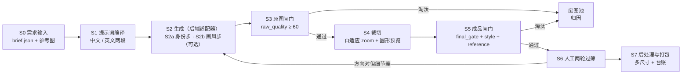

# AI 动漫头像生成方案（评审稿）

| 项目 | 内容 |
|-|-|
| 文档用途 | 方案评审 / 实施基线 / 后续迭代依据 |
| 输入依据 | 《动漫头像挑选与设置指南》（下称「验收指南」）、外部《AI 动漫头像生成实战指南》汇总（下称「st 指南」）、本机实测记录、`review\` 下的修改清单 / 方案补充清单 / 待核实项核查结果 |
| 交付形态 | 中文方案文档（本文件，唯一版本） |
| 当前路线 | 分两条：**项目默认路线**＝本地开放权重（Animagine XL 4.0 / Neta Lumina 生成 + Qwen-Image-Edit-2511 量化版锁身份），任何人无账号可复现；**维护者路线**＝宿主图生图（已实测）用于快速实验。商业 API 为用户自带 key 的可选适配器 |
| 状态 | 方向已定；仓库按**开源项目**维护；硬件将升级为 i5-14600KF + RTX 5060 Ti 16 GB，默认路线待新卡实测（见 8.1 与 `review\AI动漫头像-5060Ti实测记录表.xlsx`）。许可边界见第 9 节 |
| 范围 | 仅覆盖「用 AI 生成精致好看的动漫头像」的产品化链路，不含社区、付费、运营等业务设计 |

**修订记录**（本文档为唯一版本，后续修改直接原地更新，不再另存版本文件）

| 轮次 | 日期 | 变更 | 位置 |
|-|-|-|-|
| 初稿 | 2026-11-22 | 生成路线、质量保障、端到端链路、分期实施 | 全文 |
| 第 2 轮 | 2026-11-23 | 新增宿主文生图后端；用 4 次真实调用做能力边界实测；新增混合编排、风险与待决问题 | 2.1 / 2.3 / 4.3 / 5 / 8 / 附录 C |
| 第 3 轮 | 2026-11-23 | 对比表改为按实现简易度从轻到重排序；合并为单一版本文档 | 2.1 / 全文 |
| 第 4 轮 | 2026-11-23 | 主链路切换为纯宿主文生图；其它后端收进附录 D；质量保障改为「铺量 + 裁切补偿 + 裁切后评分」 | 0 / 2.2 / 2.5 / 2.6 / 3 / 4 / 5 / 6 / 8 / 附录 |
| 第 5 轮 | 2026-11-23 | **补齐全部生成方案并重排**：新增宿主图生图、ModelScope 在线（Qwen-Image-Edit 与 LoRA）、本地 SD1.5/SDXL + IP-Adapter/InstantID/ControlNet、Flux、商业动漫 API、自训底模，以及 st 指南的 Midjourney/Niji、Krea、Qwen-Image-Edit、SD WebUI+IP-Adapter、ComfyUI+InstantID；每个方案补「能力边界 / 准入成本 / 可复现性 / 商用许可 / 验证状态」；按简易度重建对比表；把 i2i 与 ModelScope 实测结论写回 0/1/3/4/5/8/附录，并修正与流水线 1.11.1 不一致的阈值与链路表述 | 全文 |
| 第 6 轮 | 2026-11-23 | 按开源前提并入纯口径修订：预算统一为 10 次/单；新增「占比」分母口径表；修正第 7 节目录树；说明 `raw_quality` 55 与归一化 84 两个总分口径；修订记录补日期、待决项补决策人；新增第 9 节「合规与开源边界」；把 4 条未验证主张转入 8.1 待验证实验；附录 B 标注为手写示例 | 全文 / 1.2 / 1.3 / 2.2 / 3.4 / 3.8 / 4.2 / 5.1 / 6.1 / 7 / 8 / 8.1 / 9 / 附录 B / C.2 |
| 第 7 轮 | 2026-11-23 | **按方案补充清单与核查结果修订**：拆分「项目默认路线 / 维护者路线」；硬件改为 RTX 5060 Ti 16 GB 并重写本机基线；新增动漫 SDXL 底模、Neta Lumina、两段式、构图模板 + ControlNet、云 GPU 五个方案（2.10–2.14）；修正 Qwen-Image-Edit 权重许可（Apache-2.0）、InstantID / FaceID 对动漫无效且模型非商用、Flux 无原生负向词、Midjourney 不可作后端；商业 API 补 Gemini / gpt-image / Seedream / NovelAI；质检工具链（tagger、动漫抠图、动漫脸检测）写入 3.4；9.1 换为逐组件许可表，新增 9.5「开源与商用边界」；8.1 增加 5060 Ti 实测项 | 0 / 2 / 3.2 / 3.4 / 3.7 / 4.1–4.3 / 5.1 / 7 / 8 / 8.1 / 9 / 附录 D / E |
| 第 8 轮 | 2026-11-23 | 后端适配器与 `generate.py` 已接入流水线（见 `review\AI动漫头像-后端适配器接口设计.md`）；新增第 10 节「后续开发计划」，按发布前必做 / 默认路线落地 / 质量闸门 / 生成能力 / 扩展与工程五组列出全部未开发功能；0 节「下一步」与第 7 节目录树同步；仓库根 README 重写 | 0 / 7 / 10 |
| 第 9 轮 | 2026-11-23 | 新增附录 C.5：魔搭网页端图生图实测（Qwen-Image-2.1 ×2、MiniMax-H3-Image ×2，同一份提示词.txt），首次同时锁住身份与画风；M1-5 增加与本地 Qwen-Image-Edit-2511 的 A/B，M2-6 增加复评样本 | 附录 C.5 / 10.2 / 10.3 |
| 第 10 轮 | 2026-11-23 | ModelScope API 适配器已实现（M4-1 → 待验证），可免网页手工操作调用在线推理 | 10.5 |

---

## 0. 一页结论

- **开源前提下要拆两条路线**。宿主图生图依赖维护者环境里的私有工具，ModelScope 免费推理要实名且非商用——外部用户 clone 仓库后两条都跑不通。因此：
  - **项目默认路线**：本地开放权重，任何人照 README 无账号可复现（2.9 / 2.10–2.12）。
  - **维护者路线**：宿主图生图，已实测，用于快速实验与对照（2.2）。
  - 生成后端做成**适配器**（4.2 S2），宿主 i2i、ModelScope、商业 API 都只是可选适配器。
- **默认路线候选（许可均允许商用，待新卡实测）**：
  - **Animagine XL 4.0**：SDXL 动漫底模，CreativeML Open RAIL++-M，tag 驱动（2.10）。
  - **Neta Lumina**：Lumina 2 动漫微调，主模型 Apache-2.0，中文自然语言可直接驱动；文本编码器受 Gemma 使用条款约束（2.11、9.1）。
  - **Qwen-Image-Edit-2511 量化版**：权重 Apache-2.0，Q4_K_M 约 13.2 GB，16 GB 卡可本地跑，负责「按参考图锁身份」（2.4）。
  - **两段式**：先用 Qwen-Image-Edit 锁身份，再用动漫底模低强度重绘统一画风（2.12）——直接针对下一条的核心矛盾。
- **宿主图生图（维护者路线）实测锁住了身份，没锁住画风**。身份关键项全部命中——帽型与绿色 L 徽标、蓝外套 + 白领 + 黑内搭 + 黄纽扣、黑尖刺发型、正面张嘴构图。但风格闸门 5 项全灭：饱和度 0.165、边缘密度 0.086、明度 p50 0.996、硬软边比 1.146、近白占比 0.616。主因是**订单要求纯白平涂底**，而风格闸门是用彩色、柔和、带压缩的 TV 单帧标定的；修法是用动漫抠图得到主体蒙版、风格指标只算主体区（3.4）。该判定基于现行闸门口径，复评属待验证项（8.1），不作为模型能力结论。
- **宿主文生图已降为对照**。两张纯文生图（2026-11-23 00:14）身份错误明显：帽徽是蓝色闪电而非绿色 L、缺白领与黑内搭、年龄偏大；raw 45 分。
- **硬件升级为 i5-14600KF + RTX 5060 Ti 16 GB**。6 GB 硬约束解除：SDXL、Neta Lumina 宽裕，Qwen-Image-Edit-2511 Q4_K_M 可跑，Flux.1-dev 约 37 秒 / 张。注意 5060 Ti 为 Blackwell（sm_120），**PyTorch 须为 CUDA 12.8+ 构建**；14600KF 无核显，显示器占用独显显存（2.5）。
- **几项旧判断已修正**：Qwen-Image-Edit 的「非商用」只是 ModelScope 免费推理服务的条款，**权重本身 Apache-2.0**；InstantID / IP-Adapter FaceID 依赖 InsightFace，**动漫脸常检测失败且其模型仅限非商用研究**，移出默认路线；Flux dev / schnell 原生无负向词；Midjourney 无官方 API，不作后端。
- **一致性口径**：参考图驱动下可承诺「与参考图是同一角色」；默认路线有 seed，可做同版本复现；**仍不承诺跨批次不漂移**，角色 LoRA（L3）尚未实现。
- **分期不变**：P0 协议与确认门 → P1 闸门与裁切 → P2 预算与稳定性 → P3 升级评估。

**下一步三件事**：

1. **公开发布前**：移出仓库里的第三方角色图、确定代码许可证、换上原创示例角色（10.1 M0）。
2. **新卡到手后**：导出 Qwen-Image-Edit / Neta Lumina 工作流并填绑定，按 `review\AI动漫头像-5060Ti实测记录表.xlsx` 跑 T1–T5，定默认后端（10.2 M1）。
3. **质量闸门**：接入 WD tagger v3 与 ToonOut 主体蒙版，风格闸门改算主体区，再用同一张图复评宿主 i2i（10.3 M2）。

> 后端适配器与 `scripts\generate.py` 已于 2026-11-23 接入流水线（原第 3 件事已完成）。全部未开发功能见第 10 节。

---

## 1. 背景、目标与验收基准

### 1.1 问题定义

头像的真实使用场景是好友列表里一枚极小的圆，因此「精致好看」不等于「画面精美」，而是**缩小后仍然好看**。验收指南已经给出了判断标准，本方案的工程目标就是把这些主观描述变成可测量、可回归的指标。

### 1.2 当前版本的目标（可验收）

输入一份「需求单」（角色描述 + 参考图 + 气质方向 + 目标平台 + 数量），系统输出：

1. 至少 1 张通过**原图质量闸门**（`raw_quality` ≥ 60）与**成品闸门**（`final_gate`）的头像主图（1024×1024 master）；
2. 3–6 张同批次备选，核心特征与参考图一致（发色、瞳色、服装、配饰、情绪方向），脸型允许有差异；主图与备选合计不超过单次预算（默认 10 次调用，见 3.8）；
3. 目标平台所需的尺寸包（含圆形裁切预览图）；
4. 一份台账：参考图 sha256、两段 prompt 原文、生成时间、后端与参数、裁切参数、评分明细、预算消耗——**可追溯，但不保证像素级复现**。

当前版本**明确不承诺**：同一角色跨批次不变脸、同一张图可复现、批量交付的时效 SLA。前两项分别缺 seed 与版本锁，第三项缺 SLA（见附录 D）。

### 1.3 验收基准：从文案到指标

验收指南的表述需要先量化才能自动化。**下表以流水线 1.11.1 的 `references/protocol.md` 为准**；早期版本里 `eye_center_y 0.12–0.36` 一类初值已被取代，不再作为判定依据。

| 指标 | 现行阈值 / 口径 | 说明 |
|-|-|-|
| `raw_quality` | ≥ 60（面部 40 + 构图 30 + 风格 20 + 角度 10） | 生成原图的质量分，不达标应重抽 |
| `final_gate` | 截断 / 上下留白 / 主体占比 / 画布方形 / 无边框 / 缩图可读 | 成品交付校验，不得掩盖原图不合格 |
| `face_ratio` | 0.34 ≤ x ≤ 0.82 | 脸框与裁切框交集，封顶 1.0 |
| 侧脸 `eye_center_y` | 0.32 ≤ y ≤ 0.46（目标 0.40） | 单眼、鼻尖/瞳孔定方向 |
| 正脸 `eye_center_y` | 0.24 ≤ y ≤ 0.38 | 另需双眼均检出、倾斜 ≤ 0.07、平衡 ≤ 0.08 |
| 侧脸瞳孔带 | 朝左 ≤ 0.42 / 朝右 ≥ 0.58 | 双带冲突或缺失 → `angle_undetermined` |
| `style` 闸门 | 按风格档案逐项判定（饱和度 / 边缘密度 / 明度 p50 / 硬软边比 / 近白占比 / 背景） | 任一越界记 `style_mismatch:*` |
| `reference_similarity` | `0.40×palette + 0.25×subject_sim + 0.20×edge + 0.15×value` | 真实指标；身份分记 `null`，不伪造 |

> **构图类指标一律在裁切后计算**。生成原图的构图系统性不达标，在原图上打分会把整批图误杀。

**三种「占比」的参照物不同，不能直接比较**：

| 指标 | 分子 | 分母 | 计算阶段 | 用途 |
|-|-|-|-|-|
| `face_ratio`（0.34–0.82） | 脸框与裁切框的交集，封顶为裁切框面积 | **裁切框** | 裁切后（成品） | 判断成品里脸的大小 |
| 生成时脸占比（38%–48%） | 脸框面积 | **原图**画布 | 生成期（升级后由 ControlNet 约束，当前不启用） | 约束生成端取景 |
| `subject_share`（0.40–0.985） | 非背景**内容框**面积 | 成品画布 | 裁切后（成品，`final_gate`） | 判断主体是否铺满/失控 |

> 第三项的分母是画布，但「内容框」是它的分子来源；三个数分别以裁切框、原图、内容框为参照，混用会得出相反结论。

### 1.4 非目标

- 不做写实真人头像（架构可复用，但风格体系与评分模型不同）。
- 不做视频、动态头像；不做社交/社区功能。
- 不承诺「一次生成即完美」；核心仍是**批量生成 + 强筛选**。
- 当前不做：跨批次身份锁定、像素级复现、批量交付时效承诺。
- 不接收真人照片作为参考图（除另行取得肖像授权，见 9.4）。

---

## 2. 生成路线

### 2.1 全部候选方案对比（按实现简易度排序）

排序依据：① 准入成本（要不要账号/显卡/合同）② 部署成本（从零到首图装多少东西）③ 调参成本 ④ 出图可直接用度。同档内按「可控性」排序。简易度按新硬件（RTX 5060 Ti 16 GB）评定。**「外部可复现」= 外部用户 clone 仓库后无私有工具、无实名账号即可跑通。** 项目默认路线从「外部可复现 = 是」且「商用许可 = 可」的行中选（见 2.9）。

| 排序 | 方案 | 简易度 | 代表模型 / 入口 | 能力（seed / 负向词 / 参考图 / ControlNet / LoRA） | 外部可复现 | 商用许可 | 验证状态 | 主要短板 |
|-|-|-|-|-|-|-|-|-|
| 1 | 宿主图生图（i2i）〔维护者路线〕 | ★★★★★ 零配置 | `agnes_aigc__image_to_image` / `agnes-i2i-general-model` | 无 / 无 / **有（1 张）** / 无 / 无 | **否**（私有工具） | 未确认 | **已实测** | 画风不可控；无 seed |
| 2 | 宿主文生图（t2i）〔对照〕 | ★★★★★ 零配置 | 宿主内置生图工具 | 无 / 无 / 无 / 无 / 无 | **否** | 未确认 | **已实测** | 锁不住身份；不可复现 |
| 3 | **动漫 SDXL 底模**〔默认候选〕（2.10） | ★★★★ 装 ComfyUI + 一个权重 | Animagine XL 4.0（可选 Illustrious-XL / NoobAI-XL） | 有 / 有 / 有（IP-Adapter Plus）/ 有 / 有 | **是** | Animagine 可；NoobAI 禁止；Illustrious 逐版本 | 待验证 | 只吃 tag；身份需参考图或 LoRA |
| 4 | **Neta Lumina**〔默认候选〕（2.11） | ★★★★ ComfyUI + 三个组件 | neta-lumina-v1.0 + Gemma-2B + FLUX VAE | 有 / 有 / 弱 / 弱 / 有 | **是** | 主模型可；Gemma 条款约束 | 待验证 | 仅 ComfyUI；身份参考弱 |
| 5 | **Qwen-Image-Edit-2511 本地量化**〔身份锁定〕（2.4） | ★★★★ ComfyUI + GGUF 插件 | Q4_K_M GGUF（约 13.2 GB）+ 可选 Lightning LoRA | 有 / 有 / **有（1–3 张）** / 弱 / 有 | **是** | 可（Apache-2.0） | 待验证 | 16 GB 余量紧；量化对身份影响未知 |
| 6 | **两段式：Qwen-Image-Edit → 动漫底模**（2.12） | ★★★ 两套工作流串联 | 第 5 行 + 第 3 行 img2img | 同上两行 | **是** | 可 | 待验证 | denoise 过高会冲掉身份 |
| 7 | 构图模板 + ControlNet（叠加项，2.13） | ★★★ 准备模板图 | 深度 / 姿势 / 线稿 ControlNet；可选 VRoid 渲染 | 叠加到第 3 / 6 行 | **是** | 随底模 | 待验证 | 模板需按角度分别准备 |
| 8 | ModelScope 在线 Qwen-Image-Edit | ★★★★ 实名 + token，HTTP 调用 | `Qwen/Qwen-Image-Edit` | 有 / 有 / 有（1–3 张）/ 无 / 有（换 model id） | **需实名账号** | **服务条款非商用**（权重本身 Apache-2.0） | 接口已实测；出图待验证 | 动态限流；可能下架 |
| 9 | ModelScope 在线 Qwen-Image + 风格 LoRA | ★★★★ 同上 | `Qwen/Qwen-Image` + 社区赛璐璐 LoRA | 有 / 有 / 无 / 无 / 有 | 需实名账号 | 服务条款非商用 | 待验证 | 文生图身份弱 |
| 10 | 商业 API（用户自带 key，2.7） | ★★★★ 注册 + 计费 | OpenAI gpt-image / Gemini / NovelAI / Seedream / 即梦 / 可灵 | 视平台 | 需账号 | 生成物多归用户；条款各异 | 待验证 | 黑盒；不可沉淀资产 |
| 11 | Krea AI（st 指南） | ★★★★ 网页账号 | Krea 2 (Medium) | 有 / 有 / 最多 4 张 / 无 / 有 | 需账号 | 订阅条款 | 待验证 | 主要为网页使用 |
| 12 | Flux.1 / FLUX.2-klein（2.6） | ★★★ 16 GB 可跑但慢 | Flux.1-dev（非商用）/ schnell（Apache-2.0）/ klein 4B | 有 / **原生无** / 有（Redux）/ 有 / 有 | **是** | dev 非商用；schnell 可 | 待验证 | dev 约 37 s / 张；赛璐璐需专用 LoRA |
| 13 | 云 GPU 自部署（2.14） | ★★★ 租卡 + 镜像 | 第 3–7、12 行任一 | 同所部署方案 | **是** | 随所部署模型 | 待验证 | 按时计费；镜像需固定版本 |
| 14 | 自训底模 / 角色 LoRA（2.8） | ★ 数据 + 算力 + 调参 | 在 SDXL / Qwen-Image 上继续训练 | 全有 | 是（权重自有） | 取决于底模 | 待验证 | 周期最长；需先有人工通过的原创素材 |
| — | Midjourney / Niji（st 指南） | — | `--cref` / `--oref` / `--ow` | — | **否** | 订阅条款 | 不接入 | **无官方 API，自动化调用违反服务条款**；仅人工竞品对照 |
| — | InstantID / IP-Adapter FaceID（st 指南） | — | InsightFace + SDXL | — | 是 | **InsightFace 模型仅限非商用研究** | 不接入默认 | **动漫脸常报 No face found**；身份锁定改用 IP-Adapter Plus 或角色 LoRA |

#### 2.1.1 排序依据

| 判据 | 最省事 | 最费事 |
|-|-|-|
| ① 准入成本 | 无需任何前置 | 需采购硬件或签协议 |
| ② 部署成本 | 一个输入框 | 镜像、模型、节点、workflow 全套 |
| ③ 调参成本 | 只写一句话 | 参数矩阵 + 逐风格调优 |
| ④ 出图可直接用度 | 可直接进终审 | 需大量重抽或重训 |

> **简易度 ≠ 能力上限**。第 1 行最省事但画风不可控、外部不可复现，只作维护者实验；第 3–6 行在 16 GB 卡上门槛已大幅下降，且许可允许商用，是项目默认路线的候选。最终默认后端以 5060 Ti 实测结果决定（8.1）。

### 2.2 宿主图生图（维护者路线）

| 维度 | 内容 |
|-|-|
| 能力边界 | 入参：`original_prompt` / `enhanced_prompt` / `reference_image` / `size` / `ratio`；**参考图 1 张**，无 seed、无负向词、无 strength、无 ControlNet、无 LoRA |
| 准入成本 | 零账号申请、零显卡、零依赖；按宿主配额计费（口径待核实） |
| 可复现性 | 不可复现（无 seed、无版本锁）；只能记录 prompt 与时间戳 |
| 商用许可 | 取决于宿主条款与生成内容归属；**未确认** |
| 验证状态 | **已实测**（2026-11-23 订单 `20261123-100911`，1 次调用 1 张） |

**实测能力边界**：

| 项 | 结果 |
|-|-|
| 参考图是否真传入 | 是。元数据 `mode=image_to_image` + 远端 `reference_image` URL；本地参考图 sha256 `b3b83c37…907d` 与 brief 一致 |
| 身份锁定 | **成功**：白帽冠红帽檐 + 绿色 L 徽标、蓝外套 + 白领 + 黑内搭 + 黄纽扣、黑尖刺发型、正面张嘴 |
| 画风锁定 | **失败**：风格闸门 5 项全灭；`reference_similarity` style 0.449–0.464、subject 0.799–0.856、palette 0.252 |
| 正面角度 | 画面确为正脸双眼张嘴；但闸门只检出 1 只眼（`visible_eyes=1`、`facing=right`、`is_profile=true`）→ `angle_mismatch` |
| 眼位 | `eye_center_y` 0.393（闸门）/ 0.408（双 sclera 复算），超出正脸 0.24–0.38 |
| 改掉的细节 | 脸颊闪电纹由参考图的深褐描边变成**亮黄填充**；年龄感由童年变为少年/青年 |
| 原图评分 | `raw_quality` 55 / 60（face 25、composition 30、style 0、angle 0）→ unqualified；成品闸门通过。同一台账另记归一化 `total` 84.0，两个数口径不同，见 3.4 |

**结论**：i2i 解决了「像不像这个角色」，没有解决「像不像这套画风」。它依赖维护者环境里的私有工具，外部用户无法复现，因此只作**维护者路线**：快速实验、提示词对照、闸门回归样本。画风项靠闸门修正（3.4 主体蒙版）或两段式（2.12）解决，不靠继续加提示词。画风判定基于现行闸门口径，测量修正后的复评见 8.1。

### 2.3 宿主文生图（对照 / 兜底）

| 维度 | 内容 |
|-|-|
| 能力边界 | 入参仅 prompt + 尺寸；无 seed / 负向词 / 参考图 / ControlNet / LoRA |
| 准入成本 | 零；配额口径待核实 |
| 可复现性 | 不可复现（同 prompt 两次结果不同，已实测） |
| 商用许可 | 未确认 |
| 验证状态 | **已实测**（2026-11-22 4 次能力探针 + 2026-11-23 两张角色图） |

**实测结论**：输出 1920×1920 JPEG；自然语言遵循好、精确视角与精确属性弱；眼睛纵向位置 0.40–0.45；两张角色图身份项错误（蓝色闪电徽标、缺白领与黑内搭、年龄偏大），`raw_quality` 45，`composition_bad` + `angle_undetermined`。**保留原因**：零成本、可做提示词与风格实验的对照基线；不作为交付主路线。

### 2.4 Qwen-Image-Edit（本地量化 / ModelScope 在线 / 百炼）

#### 2.4.1 接口与准入

| 维度 | 内容 |
|-|-|
| 能力边界 | `POST https://api-inference.modelscope.cn/v1/images/generations`，异步头 `X-ModelScope-Async-Mode: true`，轮询 `/v1/tasks/{task_id}`。入参含 `model / prompt / negative_prompt / size / seed / steps / guidance`；编辑模型另收 1–3 张图（base64 或 URL） |
| 准入成本 | ModelScope 账号 + **实名认证** + 绑定阿里云 + Access Token；官方称免费、非商用，按「魔方」分档抵扣（约 0.5 / 1 / 2 每次），并发按平台负载**动态限流**，只保证单并发可用 |
| 可复现性 | 中：有 seed 与参数，但免费模型可能被下架、无版本冻结、无 SLA |
| 商用许可 | **ModelScope 免费推理服务条款为非商用**；模型权重本身为 Apache-2.0，商用可改为本地自部署（2.4.4） |
| 验证状态 | 接口**已实测**：DNS/HTTPS 可达，`GET /v1/models` 未鉴权 200，`POST` 未鉴权 401；出图**待验证**（本机无 token） |

**实测探测记录**：

| 探测 | 结果 |
|-|-|
| DNS / HTTPS | `modelscope.cn` 解析正常，HTTPS 302；`api-inference.modelscope.cn` 200 |
| 模型列表 | 未鉴权返回 38 个；图像相关只有 `Qwen/Qwen-Image-Edit` 与 `MusePublic/Qwen-Image-Edit` |
| 鉴权 | 无 token 的空 POST 返回 401（`valid ModelScope token is supplied`） |
| 本机凭据 | 环境变量与 `~/.modelscope` 均无 ModelScope / DashScope token |

#### 2.4.2 能力边界与适用性

- **Qwen-Image-Edit**：指令式编辑，输入参考图 + 中文指令，保留身份的同时改画风/背景/角度；官方文档给 1–3 张图的多图编辑；Edit-2511 宣称进一步提升角色一致性。适合「同一张参考图 → 赛璐璐头像」。
- **LoRA**：在线可把 `model` 直接写成社区 LoRA 的 model id，平台自动挂载底模；当前**不支持一次传多个 LoRA**（官方称多 LoRA 链式加载在计划中）。
- **ControlNet**：没有对应参数，姿势控制只能靠指令或特定角度 LoRA。
- **Qwen-Image + 风格 LoRA**：文生图，风格权重更硬，但身份一致性弱，通常要和 Edit 串两步。

#### 2.4.3 与现状的差异

| 项 | 宿主 i2i | ModelScope Qwen-Image-Edit |
|-|-|-|
| 参考图 | 1 张，仅身份 | 1–3 张，身份 + 多图合成 |
| 负向词 | 无 | 有 |
| seed / steps / guidance | 无 | 有 |
| LoRA | 无 | 有（换 model id） |
| 中文风格指令 | 有，但不可控 | 有，且可与负向词、LoRA 共同约束 |
| 商用 | 待确认 | ModelScope 免费推理：非商用；本地自部署：可（Apache-2.0） |

#### 2.4.4 接入方式（同一模型族，四种入口）

| 接入方式 | 许可 / 条款 | 门槛 | 外部可复现 | 状态 |
|-|-|-|-|-|
| **本地 Qwen-Image-Edit-2511 Q4_K_M GGUF**〔默认〕 | 权重 Apache-2.0（量化版继承） | ComfyUI + ComfyUI-GGUF；约 13.2 GB，16 GB 卡可跑；ComfyUI 内置 `image_qwen_image_edit_2511` 模板 | 是 | 待实测（8.1） |
| 本地 + Lightning LoRA（约 850 MB） | 同上 | 采样步数 40 → 4 | 是 | 待实测：对身份保持的影响 |
| 本地 Nunchaku 4-bit | 同上 | 需对应推理插件 | 是 | 备选 |
| 阿里云百炼付费 API | 按量计费，以服务条款为准 | 阿里云账号 | 需账号 | 可选适配器 |
| ModelScope 免费推理（2.4.1） | 服务条款非商用 | 实名 + token | 需实名账号 | 接口已实测，出图待验证 |

- **版本**：选 **Edit-2511**（官方称减轻图像漂移、提升人物一致性、集成 LoRA 能力）。**不要混用 Qwen-Image-2.1**——其为研究许可，商用需另签。
- **定位**：本地量化版是「按参考图锁身份」的默认组件，可单独出图，也可作为两段式（2.12）的第一段。
- **16 GB 余量**：14600KF 无核显，显示器占用独显显存；Q4_K_M 约 13.2 GB，余量偏紧。文本编码器 offload 时占用系统内存，建议 ≥ 32 GB（推断，待实测）。

### 2.5 本地 SD 生态与本机基线

| 维度 | 内容 |
|-|-|
| 能力边界 | seed / 负向词 / 参考图 / ControlNet / LoRA **全有**；SD WebUI 与 ComfyUI 是两套前端，能力等价、后者节点化 |
| 准入成本 | 装 PyTorch（**CUDA 12.8+ 构建**）、ComfyUI（推荐）或 WebUI、2–7 GB 权重；16 GB 显存下 SD1.5 / SDXL 均宽裕 |
| 可复现性 | 高（seed + 参数 + 版本锁）；需自管镜像与模型版本 |
| 商用许可 | 逐模型核对，见 9.1；动漫底模选型见 2.10 |
| 验证状态 | **待验证**（待新卡到手后实测） |

**目标机基线（升级后）**：

| 项 | 值 | 影响 |
|-|-|-|
| CPU | Intel i5-14600KF（**无核显**） | 显示器接在独显上，占用部分显存；空载占用记入实测表「环境记录」 |
| GPU | NVIDIA RTX 5060 Ti 16 GB（Blackwell，sm_120） | 旧版 PyTorch 报「sm_120 不兼容」→ **必须安装 CUDA 12.8 或更新的 PyTorch 构建**；xformers 等加速库需对应版本 |
| 精度 | fp16 / bf16 可正常使用 | 原 GTX 16 系的 fp16 黑图 / NaN 问题不再适用 |
| 内存 | 待定，建议 ≥ 32 GB | 大文本编码器 offload |

| 路线 | 16 GB 下判断（第三方数据，待实测） |
|-|-|
| SDXL（Animagine / Illustrious） | 宽裕；8 GB 已可覆盖 SDXL |
| Neta Lumina | 官方要求 ≥ 8 GB，可跑 |
| Qwen-Image-Edit-2511 Q4_K_M | 约 13.2 GB，可跑，余量偏紧 |
| Flux.1-dev | 可流式加载，第三方同机测试约 37 s / 张 |
| SDXL 角色 LoRA 训练 | 通常可行，待实测 |

**原机基线（历史，GTX 1660 SUPER 6 GB）**：驱动 610.88、无 nvcc；Python 3.12.10，只有 Pillow；pypi 实测可达。6 GB 下 Qwen-Image 系与 FLUX.2-klein 均跑不动——此约束随换卡解除，仅保留作记录。

**适配判断**：

- **IP-Adapter FaceID / InstantID（st 指南方案四、五）不适用于动漫角色**：两者依赖 InsightFace 真人脸检测与识别，输入动漫图常直接报「No face found」；即使检出，识别向量对动漫角色判别力也很弱。另外 **InsightFace 代码为 MIT，但其预训练模型仅限非商用研究**。因此移出默认路线，仅保留为维护者本地实验备注。
- **动漫身份锁定改用**：IP-Adapter **Plus**（非 FaceID，参考整图风格与构图）、角色 LoRA，或以三视图 / 设定图作参考；或用 Qwen-Image-Edit（2.4）负责身份。
- **结论**：本地 SD 生态是「画风 + 姿势 + 可复现」都能锁的组合；新卡上门槛已降到 ★★★★，具体底模见 2.10，构图约束见 2.13。

### 2.6 Flux.1 / FLUX.2-klein

| 维度 | 内容 |
|-|-|
| 能力边界 | seed / 参考图（Redux）/ ControlNet / LoRA 可用；**dev / schnell 为蒸馏模型，原生无负向词**，需额外手段 |
| 准入成本 | Flux.1-dev **非商用许可**；schnell 为 Apache-2.0；16 GB 卡可流式加载，第三方同机测试 dev 约 37 s / 张（RTX 5090 约 8.8 s） |
| 可复现性 | 高（本地） |
| 商用许可 | dev 非商用；schnell / klein 相对宽松，需逐项确认 |
| 验证状态 | **待验证** |

**适用性**：写实与半写实强，纯赛璐璐质感需要专门 LoRA；在「动漫头像」这个目标上不是首选，只在需要厚涂/插画质感时作为风格档补充。注意 FLUX 的 16 通道 VAE（`ae.safetensors`）按 Apache-2.0 发布、dev 与 schnell 共用；Neta Lumina 使用的正是该 VAE，与 dev 主模型的非商用许可无关。

### 2.7 商业 API 与在线平台（可选适配器，用户自带 key）

| 平台 | 能力 | 生成物权利 | 关键条款 | 适配器 | 验证状态 |
|-|-|-|-|-|-|
| OpenAI gpt-image | 参考图编辑 | 用户拥有 Output，OpenAI 转让其权利 | 遵守使用政策 | 可选 | 待验证 |
| Google Gemini 图像 | 多参考图编辑、身份保持 | Google 不主张生成内容所有权 | **须年满 18 岁、不得用于面向未成年人的服务**；**免费档提交内容与结果会被用于改进 Google 产品 → 参考图不走免费档**；不得绕过安全过滤 | 可选 | 待验证 |
| NovelAI | 动漫专用模型；有 API | 用户保留全部权利，条款未禁止商用 | 须年满 18 岁；**不得共享账号、不得转售服务**；自动化不得无视服务限制或造成过大负载；图生图参考图加密短期缓存后自动删除 | 可选（必须内置限速） | 待验证 |
| 火山方舟 Seedream | 官方教程：文本、单图、多图输入，文生图 / 多图融合 / 编辑 | **待核实**（服务协议需登录控制台查看） | 待核实 | 核实前不接入 | 待验证 |
| 即梦 / 可灵 | 参考图与负向词视平台而定 | 待核实 | 条款限制多 | 待定 | 待验证 |
| Krea AI（Krea 2 Medium） | 最多 4 张加权参考、情绪板、LoRA | 订阅条款 | 主要为网页使用 | 不接入 | 待验证 |
| Midjourney / Niji | `--cref` / `--oref` / `--ow` / `--no` | 订阅条款 | **无官方 API，自动化调用违反服务条款** | **不接入** | 仅人工竞品对照 |

**定位**：竞品参照与长尾补位，作为「用户自带 key、仅本地使用、内置限速」的可选适配器，**默认不启用**。仓库不得内置任何共享 key，也不得把这些服务封装成托管服务对外提供（NovelAI 明确禁止转售与共享账号）。年龄与数据条款写入 README。

### 2.8 自训底模 / 角色 LoRA

| 维度 | 内容 |
|-|-|
| 能力边界 | 全参数可控；可把角色与画风固化成资产 |
| 准入成本 | 20–40 张稳定素材 + 训练算力 + 调参；ModelScope AIGC 专区可在线训练 Qwen-Image LoRA，本地可训 SD LoRA |
| 可复现性 | 高（权重即版本） |
| 商用许可 | 取决于底模许可与训练数据来源，必须逐项确认 |
| 验证状态 | **待验证**（无素材集、无训练记录） |

**前提**：先产出「人工通过」的稳定素材，再训练；**不能用未通过的候选训练**，否则会把漂移固化。训练素材须为**原创或已授权角色**（9.3）；底模若为 NoobAI / Illustrious 等 fair-ai 许可，衍生 LoRA 必须开源并公开训练配方（9.1）。16 GB 卡上 SDXL LoRA 训练通常可行，记录于实测表「LoRA训练」页。

### 2.9 路线选定与升级路径

**两条路线并行**：

| 路线 | 组成 | 谁用 | 外部可复现 | 状态 |
|-|-|-|-|-|
| **项目默认路线** | 生成：Animagine XL 4.0（tag）或 Neta Lumina（中文）；身份：Qwen-Image-Edit-2511 Q4_K_M；组合：两段式（2.12）；构图：模板 + ControlNet（2.13，可选） | 外部用户 / README 默认 | 是 | 待 5060 Ti 实测后定稿 |
| **维护者路线** | 宿主图生图（2.2）；宿主文生图作对照 | 维护者快速实验 | 否 | 已实测 |

**默认路线定稿规则**（按实测表「汇总」页）：

1. 先比 T1（Animagine）与 T2（Neta Lumina）：白底头像下风格闸门通过率、96px 可读率、单图耗时。胜者为默认生成底模；另一个保留为可选。
2. 再比 T3a / T3b（Qwen 40 步 / 4 步）：身份五项均值不低于宿主 i2i 实测水平即可采用；4 步若身份五项下降 ≤ 0.3 则默认用 4 步。
3. 最后比 T4a–c（两段式 denoise 0.25 / 0.35 / 0.45）：取「风格闸门通过 且 身份五项 ≥ 4」的最大 denoise。
4. 任一项峰值显存 ≥ 15 GB 或出现 OOM，则该项默认改为更低量化或关闭显示器硬件加速后复测。

**升级路径与触发条件**（默认路线之上）：

| 顺序 | 路线 | 触发条件 | 要补的验证 |
|-|-|-|-|
| 1 | 构图模板 + ControlNet（2.13） | 眼位 / 角度合规率 < 90% | ControlNet 构图精度、眼位分布 |
| 2 | 角色 LoRA（2.8） | 同一角色需要跨批次稳定；已有 20–40 张人工通过的原创素材 | 训练耗时、身份五项提升、回归基线 |
| 3 | 云 GPU（2.14） | 需要全精度 Qwen-Image-Edit、批量评测或本机训练 OOM | 单次评测成本、镜像可复现 |
| 4 | Flux（2.6） | 需要厚涂 / 插画质感档 | 吞吐、二次元 LoRA、与 SDXL 风格不串味 |
| 5 | 商业 API 适配器（2.7） | 用户自愿自带 key | 条款写入 README、限速 |

### 2.10 动漫专用 SDXL 底模（默认候选）

| 模型 | 特点 | 许可 | 可否作默认 |
|-|-|-|-|
| **Animagine XL 4.0（含 Opt）** | 由 SDXL 1.0 重训，约 840 万张动漫图；tag 排序训练；Opt 版改善稳定性、解剖与饱和度 | **CreativeML Open RAIL++-M**：可商用、修改、分发；有用途限制条款；需附许可副本 | **是** |
| Illustrious-XL | LoRA 生态最大，原生高分辨率 | **各版本不一致**：v0.1 为 fair-ai-public-license（不鼓励牟利、衍生须开源）；v2.0 在 HF 元数据标为 creativeml-openrail-m，但模型卡正文未载明；部分版本未开源 | 否（逐版本确认后可选） |
| NoobAI-XL | 基于 Illustrious；Danbooru + e621；booru tag 覆盖最深 | fair-ai-public-license-1.0-sd **+ 追加条款：禁止任何形式商用，明确包括模型生成的产品**；衍生须开源 | **否**（可选，标注非商用） |

- **推荐参数（Animagine）**：1024×1024；CFG 4–7（推荐 5）；25–28 步；Euler a。
- **提示词结构**：`1girl/1boy, 角色, 作品, 分级, 其它 tag, 质量 tag`；质量 tag 置尾：`masterpiece, high score, great score, absurdres`。
- **分级**：模型支持 `safe / sensitive / nsfw / explicit`，**提示词编译层强制写入 `safe`**，负向词写入 `nsfw, explicit`（9.4）。
- **限制**：只吃 tag，自然语言效果差——需要「中文需求单 → tag」的编译层（S1），或改用 Neta Lumina。
- **身份**：底模本身不锁身份；需配合 IP-Adapter Plus、角色 LoRA，或走两段式（2.12）。

### 2.11 Neta Lumina（默认候选，中文驱动）

| 维度 | 内容 |
|-|-|
| 来源 | Neta.art Lab 基于上海 AI Lab 开源的 Lumina-Image-2.0 微调，超过 1300 万张动漫图 |
| 组件 | 主模型 `neta-lumina-v1.0`；文本编码器 Gemma-2B；VAE 为 16 通道 FLUX VAE；另有 all-in-one 合并版 |
| 提示词 | Danbooru tag、自然语言、中英日混写均可（官方推荐中 / 英 / 日） |
| 运行 | **目前只支持 ComfyUI**；≥ 8 GB 显存；推荐 res_multistep / euler_ancestral、linear_quadratic、30 步、CFG 4–5.5、1024×1024 |
| 许可 | **主模型 Apache-2.0；VAE Apache-2.0；Gemma-2B 受 Gemma 使用条款约束**（不能整体标为 Apache-2.0，见 9.1） |
| 适用性 | 与现有「中文 `original_prompt` + 英文 `enhanced_prompt`」两段式衔接最自然，可省掉 tag 编译层 |
| 待验证 | 白底头像下的风格闸门表现；身份参考能力（大概率需配合 Qwen-Image-Edit） |

### 2.12 两段式「身份 → 画风」

针对 2.2 的核心矛盾（i2i 锁住身份、锁不住画风），把两件事拆成两步：

```
参考图 ─► S2a 身份步：Qwen-Image-Edit-2511（或宿主 i2i）
              按参考图出身份正确、构图合规的图
         ─► S2b 画风步：Animagine XL 4.0 + 风格 LoRA，img2img
              denoise 0.25 / 0.35 / 0.45 三档实测
         ─► S3 原图闸门
```

- **附带收益**：可修正细节漂移（如脸颊闪电纹由深褐描边变亮黄）。
- **风险**：denoise 过高会冲掉身份。画风步前后各跑一次 WD tagger，比较身份五项属性标签（3.4）。
- **定档规则**：见 2.9 第 3 条。

### 2.13 构图模板 + ControlNet

- **目的**：眼位越界、角度误判都源于生成期构图不确定；把构图从「事后裁切补偿」改为「生成期确定」。
- **做法**：
  - 按角度准备头肩构图模板（深度图 / 姿势图 / 线稿）：正脸 `eye_center_y` 预设约 0.31、侧脸约 0.40；头顶留白、肩线、左右边距按 3.2 数值。
  - 生成期用 ControlNet 约束，叠加到 2.10 或 2.12 的画风步。
  - 进阶：用 VRoid 等 3D 模型渲染正脸 / 侧脸 / 3/4 侧，转深度或线稿作约束。
- **许可**：ControlNet 权重逐个核对；模板图使用原创素材。

### 2.14 云 GPU 自部署

- **用途**：本机 16 GB 不够时的补充——全精度 Qwen-Image-Edit、批量评测、大批量训练。
- **形态**：按小时租 24 GB 级显卡（如 AutoDL、RunPod 等）；镜像固定 PyTorch / ComfyUI / 模型版本，写入 manifest。
- **待验证**：单图耗时、单次评测成本、镜像可复现。

---

## 3. 质量保障体系（流水线 1.11.1）

整体思路是**生成后补偿**，而不是指望生成期精确控制：

```
参考图 + 双段提示词 → 生成 → 原图闸门（raw_quality） → 裁切 → 成品闸门（final_gate） → 人工过筛 → 打包
```

### 3.1 提示词体系

| 层 | 内容 | 来源 | 当前写法 |
|-|-|-|-|
| L0 固定句 | 参考图是身份与画风的唯一权威，只改角度、构图与背景 | 协议固定句 | `<image 1> 是身份与画风的唯一权威，只改角度、构图与背景。` |
| L1 角度 | 正面 / 侧脸方向 + 可见眼数 | 角度矩阵 | 「正脸，双眼可见且水平对称」或「接近正侧脸，鼻尖朝左」 |
| L2 表情 | 张嘴 / 浅笑 / 冷峻 | 需求单 | 「张嘴大笑，口腔与舌头清晰可见」 |
| L3 构图 | 头像/胸像、肩线入镜、方形满出血 | 协议 | 「头部居中，肩线完整入镜」 |
| L4 背景 | 纯白平涂 / 浅色 | 需求单 | 「干净纯白平涂背景」 |
| L5 画布条款 | 方形、无边框、无圆形遮罩 | 协议 | `square canvas, no border, no frame, no circular mask, edge-to-edge` |

**两段式**：`original_prompt` 用中文，`enhanced_prompt` 用英文，语义一致；固定句必须置顶。宿主 i2i **没有负向通道**，排除项只能写成描述句。默认路线另有分支：Animagine 走「中文需求单 → Danbooru tag」编译（强制 `safe`，负向词含 `nsfw, explicit`）；Neta Lumina 直接用中文；Qwen-Image-Edit 用中文指令 + 负向词。宿主 i2i 下不承诺 S1 硬边赛璐璐的稳定复现（实测风格闸门全灭）。

### 3.2 构图与裁剪：宿主 i2i 的唯一补偿手段（默认路线另有 2.13）

| 规则 | 数值 | 当前状态 |
|-|-|-|
| 取景 | 胸像以上 | 参考图 + 描述，基本生效 |
| 生成时脸占比 | 38%–48% | 默认路线经构图模板 + ControlNet 启用（2.13）；宿主 i2i 不可用 |
| 头顶留白 | ≥ 10% 画面高 | 软约束，常失效 |
| 肩线 | 画面下 25% 以内 | 基本生效 |
| 左右安全边距 | ≥ 8% 画面宽 | 常失效 |

**裁切规则**：以人脸框/内容框反解 zoom，目标脸占比 0.62；以双眼中点为锚；每图输出 2–3 个候选；同时渲染圆形预览。

### 3.3 一致性

| 级别 | 手段 | 当前状态 | 说明 |
|-|-|-|-|
| 描述级（批次内） | 同描述 + 多抽 | **启用** | 只能做到「像同一角色」 |
| L1 参数锁 | 固定 seed | 默认路线**可用**；宿主后端不可用 | 本地后端有 seed + 版本锁，可做同版本复现 |
| L2 身份参考 | 参考图注入 | **启用**（宿主 i2i 已实测；Qwen-Image-Edit 待实测） | 宿主 i2i 实测可锁帽徽/服装/发型 |
| L3 角色 LoRA | 训练角色 LoRA | **未实现** | 需先有稳定素材 |

**可承诺口径**：参考图同批次的核心特征一致；**不承诺**脸型、发型细节、五官比例跨批次一致。

### 3.4 闸门与评分

**原图闸门 `raw_quality`（≥ 60）**：

| 维度 | 分值 | 判定 |
|-|-|-|
| 面部/轮廓 | 40（conf ≥0.6）/ 25（≥0.4）/ 0 | 人脸可信度 |
| 构图 | 30（内容闸门过）/ 15（未判定）/ 0 | 内容框、截断、留白、主体占比 |
| 风格 | 20（过）/ 0 | 风格档案逐项 |
| 角度 | 10（过）/ 5（未判定）/ 0 | 角度闸门 |

**两个总分口径，不可互相替代**：

| 字段 | 口径 | 实测值（订单 `20261123-100911`） | 用途 |
|-|-|-|-|
| `raw_quality.total` | 固定百分制：face 40 + composition 30 + style 20 + angle 10；不通过或不可判定记 0 | 55（25 / 30 / 0 / 0） | 原图是否达标、是否重抽 |
| `total` / `best_total` | 按可用维度归一化：`face_quality × 40% + composition × 60%`；style / angle 记 `null` 时不计入分母 | 84.0（74.8 / 90.2） | 排序、看板与候选比较 |

前者是**判定**口径，后者是**排序**口径。84 不代表该图合格（`verdict=REJECT`），也不能抵消 `raw_quality` 的未通过项。

**成品闸门 `final_gate`**：画布方形、无边框/圆形遮罩、上留白 0.015–0.16、下留白 ≤0.18、主体占比 0.40–0.985、头顶不平切、缩图可读。

**风格闸门**（`tv-anime-cel` 当前档）：饱和度、边缘密度、明度 p50、硬软边比、近白占比、背景模式。实测冲突：纯白底会把 `value_p50`、`near_white`、`saturation` 同时推爆，**需要把指标从全图改为主体区**（见第 8 节）。落地方式：用 ToonOut 得到主体 alpha 蒙版 → 饱和度、边缘密度、明度 p50、硬软边比只在蒙版内计算；`near_white_share` 改为蒙版外的背景纯净度校验。风格档案后续改为「从本角色参考图主体区提取 + 容忍带」，每角色一份。

**闸门实现依赖（质检工具链）**：

| 工具 | 用途 | 填补的空位 | 许可 | 默认启用 |
|-|-|-|-|-|
| WD EVA02-Large Tagger v3（ONNX，CPU 可跑） | 属性标签（帽子、领口、发色、瞳色等）；分级标签 general / sensitive / questionable / explicit | 身份五项自动初判（`identity` 不再恒为 `null`）；NSFW 初筛（9.4） | Apache-2.0 | 是 |
| PixAI Tagger v0.9（备选） | 同上，标签更新 | 同上 | Apache-2.0 | 备选 |
| ToonOut（BiRefNet 动漫抠图微调） | 主体 alpha 蒙版；动漫测试集像素精度 95.3% → 99.5% | 风格指标只算主体区；透明 PNG 输出（4.4） | MIT | 是 |
| deepghs yolo-face（动漫脸检测） | 脸框、眼睛定位 | 替代按饱和度找瞳孔（黑瞳漏检，`SAT_MIN=60`） | RDL 转载免责声明，上游许可需逐个追溯 | 否（可选插件） |
| Aesthetic Predictor V2.5（SigLIP） | 美学分，用于候选排序 | 补充 `total` / `best_total` 排序口径 | **AGPL-3.0** | 否（可选插件，避免 AGPL 传染主仓库） |

**参考相似度**：`0.40×palette + 0.25×subject_sim + 0.20×edge + 0.15×value`；`subject_hsv` 用圆均值；身份分不伪造。

### 3.5 人工筛选

| 轮次 | 输入 | 动作 | 时间预算 | 输出 |
|-|-|-|-|-|
| 粗筛 | 一屏 12 张圆形预览 | 只看脸、眼睛、情绪；勾选保留 | ≤ 60 秒/屏 | 每需求 3–5 张 |
| 精筛 | 保留图 1024 方形 + 评分明细 | 对照验收清单逐项确认 | ≤ 2 分钟 | 定稿 1–2 张 |
| 补量 | 方向对但细节差 | 同方向再出 4 张 | ≤ 3 分钟 | 补充候选 |

驳回理由码：崩手 / 脸糊 / 风格不对 / 不像同一人 / 构图差 / 情绪不符 / 背景脏 / 有文字。

### 3.6 后处理

| 环节 | 当前状态 | 说明 |
|-|-|-|
| 自动裁切 | **启用** | 核心补偿，见 3.2 |
| 按需超分 | **启用（仅 Lanczos）** | 缺依赖一律回退 Lanczos |
| 轻锐化 | **按需** | USM 半径 0.3–0.5、量 3–8% |
| 局部重绘修脸 | 宿主 i2i **不可用**；默认路线可用 | 本地 ComfyUI 可做 ADetailer 式局部重绘（检测器许可见 3.4） |
| 高清重绘 hires | **不需要** | 原生 1024/1920，裁到 1024 是降采样 |
| 多尺寸导出 | **启用** | 1024/640/512/360/256/200 + 圆形预览 |

### 3.7 高清放大四类路线

**结论**：头像是小尺寸展示物，4K 属锦上添花。默认 2K 用 Lanczos；要 4K 且要求增细节时才走动漫专用超分；生成式重绘只在 denoise ≤ 0.25 时使用。任何后端缺失一律回退 Lanczos 并记 manifest。

| 路线 | 是否本地 | 依赖 | 是否增细节 | 头像适用度 | 推荐场景 |
|-|-|-|-|-|-|
| Lanczos / Bicubic | 是 | Pillow（已具备） | 否 | 高 | **2K 默认** |
| Real-ESRGAN anime / waifu2x | 是（需安装） | Vulkan exe 或 torch；16 GB 宽裕 | 是 | 最高 | **4K 增细节首选** |
| SwinIR / 4x-UltraSharp | 是（需 torch/ONNX） | tiling | 是（通用） | 中 | 动漫专用不可用时备选 |
| Topaz / Magnific | 本地商业 / 云端 | 授权 / 订阅 | 是 | 中（易改脸） | 有人工复核时 |
| SD tile 重绘 | 是（ComfyUI+模型）/ 云 | torch + SD1.5/SDXL；16 GB 可行 | 是（生成式） | 低 | 仅 denoise ≤0.25 修背景/发丝 |

**环境更新**：换 RTX 5060 Ti 16 GB 后，Real-ESRGAN anime / waifu2x、SwinIR 均可在本机运行；PyTorch 须为 CUDA 12.8+ 构建。`realesrgan-ncnn-vulkan`、`waifu2x-ncnn-vulkan` 仍未安装，许可上线前逐个核对。

### 3.8 预算与台账

- 每单预算默认 **10 次调用**；当前宿主 i2i 一次 1 张，故「次」与「张」等价。`rounds.json` 按 `order_id` 累计 `budget_used`；超预算必须停下确认。
- 升级到一次可出多张、或带批量重抽的后端后，「次」与「张」不再等价：台账分别记 `calls` 与 `images`，预算以 `calls` 为准。
- 每轮生成前 `rounds.py --reconcile`：盘上有但未记账的图补 `unaccounted`；`--record` 的 `--count` 小于文件数直接拒绝。
- 台账记：参考图路径与 sha256、两段 prompt 原文、后端与参数、调用次数、产出文件、闸门分数与原因码、裁切参数、预算余额。

---

## 4. 端到端链路

### 4.1 流程图（参考图驱动）



### 4.2 各环节契约

| 阶段 | 输入 | 处理 | 输出 | 失败处理 |
|-|-|-|-|-|
| S0 | 角色描述、参考图、角度、表情、背景、数量、IP 状态 | 校验；参考图复制并记 sha256；拒收真人照片（无肖像授权时）；记录 `ip_status`（原创 / 已授权 / 第三方仅内部）；缺省值标注 | `brief.json` | 字段冲突 → 提示并给建议组合；真人照片 → 拒收 |
| S1 | `brief.json` | 固定句 + 角度 + 表情 + 构图 + 背景；中英两段 | `prompts.json` | 编译失败 → 回退最简模板 |
| S2 | prompts + 参考图 | 经**后端适配器**调用（`backends/<name>.py`，统一入参：prompt、negative、参考图列表、seed、size；统一出参：图片 + 元数据）。默认适配器为本地 ComfyUI（2.9），宿主 i2i、ModelScope、商业 API 为可选适配器；两段式时依次执行 S2a / S2b；每张计数 | `*-avatar-N-src.png` + manifest（记录适配器名、模型版本、seed） | 失败退避重试 1 次；超预算熔断；商业 API 适配器内置限速 |
| S3 | 生成原图 | 人脸/内容/构图/风格/角度 | `raw_quality` + 原因码 | 不达标 → 重抽，不放宽阈值 |
| S4 | 通过原图闸门的图 | 反解 zoom、2–3 候选裁切 | `crop/*`、`preview/*` | 无脸/多人 → 废图 |
| S5 | 裁切图 + 参考图 | 成品闸门 + 风格（主体蒙版内）+ 角度 + 参考相似度 + WD tagger 身份属性与分级（`questionable` / `explicit` 判不通过；未接入时记 `null`，不判通过） | `scores` + 入选清单 | 异常 → 标 `unscored`；NSFW 命中 → 废图池 |
| S6 | Contact Sheet + 明细 | 粗筛 → 精筛 | `review.csv` | 超时保留待审，不自动通过 |
| S7 | 定稿图 | 超分、多尺寸、圆形预览、写入 AIGC 标识（显式 + 元数据隐式）、台账 | `deliver/` + 标识记录 | 超分失败 → 回退 1024 |

### 4.3 宿主 i2i 与默认路线的环节差异

| 环节 | 宿主 i2i（维护者路线） | 默认路线（本地 ComfyUI） | 宿主 i2i 为什么没有 |
|-|-|-|-|
| 提示词编译 | 固定句 + 中英两段 | 加 Animagine tag 分支、Neta Lumina 中文分支、Qwen 中文指令分支 | 只有一个后端 |
| 参考图控身份 | **已启用** | 多参考图 / 多图合成 | i2i 只收 1 张 |
| seed / 参数锁 | 无 | seed + 参数指纹 + 版本锁 | 宿主无 seed |
| ControlNet 构图 | 无 | OpenPose / Depth / Lineart | 宿主无该入参 |
| LoRA 风格 | 无 | 风格 LoRA / 角色 LoRA | 宿主无 LoRA |
| 局部修脸 | 无 | ADetailer / 局部重绘 | 无局部重绘与蒙版入口 |
| 高清重绘 | 不需要 | hires fix | 原生分辨率已够 |

### 4.4 平台适配规格

| 平台类型 | 代表 | 展示形态 | 推荐输出 | 备注 |
|-|-|-|-|-|
| 国内社交 | 微信、QQ | 圆形 / 圆角方 | 640 / 360 / 200 | 360 为常见安全下限 |
| 内容社区 | B 站、微博、小红书、抖音 | 圆形 | 512 / 360 / 200 | 会被二次压缩，控噪点 |
| 游戏/工具 | Steam、Discord、GitHub、Telegram | 圆形 / 方形 | 512 / 256 / 128 | 部分支持透明背景；用 ToonOut 蒙版另出一档透明 PNG |

master 统一 1024×1024 PNG；对外 1024/640/512/360/256/200 六档；社交优先 JPEG 92 或 WebP；圆形预览单独输出。上传限制会变，上线前逐项核对官方规则。

### 4.5 台账与可追溯性

`manifest.json` 记：适配器名、模型与版本（含量化档）、`reproducible`（宿主后端 `false`；本地后端在 seed + 模型版本 + 依赖版本齐全时为 `true`）、seed、参考图路径与 sha256、两段 prompt 原文、调用时间、尺寸、裁切参数、闸门分数与原因码、评分版本、后处理链路版本、驱动 / CUDA / PyTorch / ComfyUI 版本、AIGC 标识方式、预算消耗。

**宿主 i2i / t2i 的产物不得进入回归基线集，也不得作为角色 LoRA 的训练素材**（会把漂移固化）。台账用于归因，不用于复现。

---

## 5. 实施计划

不排工期，只定义范围、出口条件与验证方式。

### P0 · 协议与确认门

| 项 | 内容 |
|-|-|
| 范围 | brief 结构、参考图归档与 sha256、两段 prompt 编译、确认门（未确认不生成）、单张预算 |
| 必须产出 | 可复跑的 brief → prompt → 调用 → 落盘链路；确认块字段完整 |
| 出口条件 | 未确认时流水线拒绝执行；参考图 sha256 与 brief 一致；prompt 固定句置顶 |
| 验证方式 | 离线校验 + 一次真实单图调用 |

### P1 · 闸门与裁切

| 项 | 内容 |
|-|-|
| 范围 | raw_quality、final_gate、style、angle、reference_similarity、裁切与圆形预览 |
| 必须产出 | 阈值标定报告（200–300 张标注集）；原因码统计；裁切合规率 |
| 出口条件 | `pass@4` ≥ 70%；构图三项合规率 ≥ 90%；96px 可读率 ≥ 95% |
| 主要风险 | 风格闸门与纯白底冲突；正脸黑瞳检测失败（已实测） |

### P2 · 产能与稳定性

| 项 | 内容 |
|-|-|
| 范围 | 预算台账、限流与熔断、断点续跑、批量任务队列、气质预设库 |
| 必须产出 | 20/50 连发压测；连续 3 天稳定出图；单需求成本区间 |
| 出口条件 | 目标日需求不断供；失败可恢复或告警；单需求人工 ≤ 3 分钟 |

### P3 · 升级评估

先按 2.9「默认路线定稿规则」在 5060 Ti 上完成 T1–T5 实测并定稿默认后端；再按 2.9 升级路径表的触发条件选择：构图模板 + ControlNet、角色 LoRA、云 GPU、Flux、商业 API 适配器。对外发布前，按 9.1 逐组件核对许可。

### 5.1 风险总表

| 风险 | 影响 | 缓解 |
|-|-|-|
| **画风不可控** | 生成端只锁身份；风格闸门 5 项全灭 | ① 风格指标改为主体区计算；② 升级 ModelScope 用负向词 + LoRA 锁画风 |
| **风格闸门与纯白底冲突** | 合规成品被判 style=0，raw 直接差 30 分 | 先修指标口径，再谈模型；不要把阈值当模型问题 |
| **正脸双眼检不出** | 黑虹膜（实测 sat 14–21）不满足 `SAT_MIN=60`，退化成单眼侧脸 | 补双 sclera 配对路径；眼位区间是否重标定由评审决定 |
| **不可复现** | 无法回归、无法「再来一张」 | 台账归档 + 统计口径回归；升级 seed |
| **配额 / 限流** | 批量断供 | 预算 ≤10 次/单（与 3.8 一致）；退避 + 熔断 + 断点续跑 |
| **商用许可未确认** | 对外交付可能违约 | 法务清单先行；未确认前只做内部验证 |
| **宿主模型静默更新** | 风格漂移、基线失效 | 固定 prompt 双周复跑；manifest 记版本 |
| **人工过筛瓶颈** | 产能上不去 | 粗筛只看圆图/脸/情绪，≤60 秒/屏 |
| **ModelScope 免费推理非商用** | 经该服务产出的图不可商用 | 默认路线改为本地 Qwen-Image-Edit（权重 Apache-2.0）；ModelScope 仅作可选适配器 |
| **真人脸模型对动漫无效** | InstantID / FaceID 报 No face found；InsightFace 模型非商用 | 移出默认路线；身份改用 Qwen-Image-Edit、IP-Adapter Plus 或角色 LoRA |
| **Blackwell 兼容** | 旧版 PyTorch 在 5060 Ti 上报 sm_120 不兼容 | README 写明 PyTorch CUDA 12.8+；实测表「环境记录」登记版本 |
| **16 GB 余量** | 无核显，显示器占显存；Qwen Q4_K_M 约 13.2 GB | 关闭不必要的 GPU 加速程序；必要时 offload 或换更低量化；超 15 GB 标红复测 |
| **许可链复杂** | 单个模型由多个组件构成，许可不一致（如 Neta Lumina 含 Gemma 条款） | 9.1 逐组件列示；下载脚本逐组件展示许可并要求确认 |
| **角色 IP 权属** | 参考图与成品可能侵权，仓库不得分发 | 内部验证限定；对外用原创或已授权角色；见 9.3 |
| **AIGC 标识缺失** | 发布可能不合规 | 显式 + 隐式标识写入台账；义务需自行核实；见 9.2 |
| **内容安全** | NSFW / 未成年 / 真人照片风险 | S0 拒收真人照片；提示词拦截；NSFW 接入前记 `null`；见 9.4 |
| **开源许可混用** | 仓库 LICENSE 被误当作模型许可；AGPL 插件传染主仓库 | 代码、模型、数据三套许可分别列示；AGPL 组件只作可选插件；见 9.1 |

---

## 6. 度量与验收

### 6.1 核心指标

| 指标 | 定义 | 目标 |
|-|-|-|
| `pass@1` | 单张通过全部闸门 + 人工终审 | P1 末 ≥ 30% |
| `pass@4` | 4 张里至少 1 张通过 | P1 末 ≥ 70% |
| 裁切合规率 | 构图三项全过 | ≥ 90% |
| 小图可读率 | 96×96 可检出人脸 | ≥ 95% |
| 身份一致率 | 与参考图五项核心特征全一致（人工） | 观察项，≥ 90% |
| 单需求调用次数 | 含重抽 | ≤ 10（与 3.8 预算一致） |
| 单需求人工耗时 | 候选到交付 | P0 ≤ 10 min，P1 ≤ 5 min，P2 ≤ 3 min |

### 6.2 评测集与回归

- 规模：50–100 条需求单，覆盖 5 气质 × 常见平台 × 难例（侧脸、发饰多、深色背景、浅色瞳、长发贴边）。
- 标注：2 人双盲，分歧由第三人仲裁；记录通过/驳回 + 理由码。
- 回归触发：改 prompt 模板、裁切规则、评分权重、后端版本。
- 不可复现下的口径：不比固定图，比统计指标（每条 brief 跑 4 次取均值），容忍带 ±5%。

---

## 7. 目录与产物

```
f:\zxc\Project\sdz-ptah\
├── design\
│   ├── outputs\
│   │   └── AI动漫头像生成方案.md      # 本文档（唯一版本）
│   ├── review\                         # 评审与过程材料（非交付物）
│   │   ├── AI动漫头像生成方案-修改清单.md
│   │   ├── AI动漫头像生成方案-方案补充清单.md
│   │   ├── AI动漫头像生成方案-待核实项核查结果.md
│   │   ├── AI动漫头像-5060Ti实测记录表.xlsx
│   │   └── AI动漫头像-后端适配器接口设计.md
│   └── probe\                          # 宿主文生图实测样本（证据；含第三方角色图，公开前移出，见 10.1）
├── README.md                           # 项目说明、快速上手、许可与路线图摘要
├── skills\install.py                   # 把 skill 链接 / 复制到宿主技能目录
├── skills\sdz-ptah-avatar\             # skill 实现；与 design 同级
│   ├── SKILL.md                        # 执行入口（宿主智能体按此执行）
│   ├── scripts\
│   │   ├── avatar_pipeline.py          # 闸门 + 裁切 + 导出（1.11.1）
│   │   ├── confirm_order.py            # 确认门 + 参考图归档 + 分段 / seed / 外发同意
│   │   ├── generate.py                 # 生成入口：调后端适配器、预算预检、记账、续跑
│   │   └── rounds.py                   # 预算与满意度台账
│   ├── backends\                       # 后端适配器：ComfyUI 本地 / 宿主侧（Agnes、TRAE）/ mock
│   ├── workflows\                      # ComfyUI API 格式工作流：sdxl_t2i / sdxl_i2i（Qwen / Neta Lumina 待导出）
│   ├── tools\download_models.py        # 〔未开发〕逐组件展示许可并确认后下载；权重不入库（10.6）
│   └── references\
│       ├── protocol.md                 # 可执行阈值与原因码
│       ├── backends.json               # 1.0 后端注册表（兼容保留）
│       ├── backends.v2.json            # 2.0 后端注册表（默认读取）
│       ├── angles.json / feedback.json
│       ├── styles\tv-anime-cel.json / realistic-armor.json
│       └── characters\satoshi.json / fox-armor.json   # 第三方 IP 示例，公开前替换（10.1）
└── 订单目录（宿主侧，不入库）
    └── <角色>\avatar-orders\<order_id>\
        ├── brief.json / rounds.json / status.json / generation.json
        ├── <prefix>-ref-N.png          # 参考图（平铺，不入库）
        ├── <prefix>-avatar-N-src.png   # 生成原图
        ├── <prefix>-avatar-N.png       # 成品
        └── manifest.json               # 台账
```

---

## 8. 待决问题

| # | 问题 | 影响 | 建议 | 决策人 |
|-|-|-|-|-|
| 1 | ModelScope 账号 / token 与参考图外发授权 | 只影响可选适配器（默认路线已改为本地 Qwen-Image-Edit） | 有需要再申请；未授权前不调用 | 项目负责人（账号持有人） |
| 2 | 商用许可与内容权属（宿主 + ModelScope） | 决定能否对外交付 | 法务先行；ModelScope 免费仅非商用 | 项目负责人 + 法律意见 |
| 3 | 风格闸门是否改为只算主体区 | 决定合规成品会不会被误杀 | 建议改；改前不动阈值 | 项目负责人（技术） |
| 4 | 正脸 `eye_y` 上限 0.38 是否按大头像重新标定 | 决定正脸图能否过闸 | 实测 0.393–0.408，需评审决定；本轮不放宽 | 项目负责人（技术） |
| 5 | 是否接受「不承诺跨批次不变脸」 | 决定产品承诺 | 建议写进产品说明 | 项目负责人（产品） |
| 6 | 升级路径复评节奏 | 决定何时启用构图模板、角色 LoRA、云 GPU、Flux | 按 2.9 触发条件命中即启动 | 项目负责人（技术） |
| 7 | 合规边界：AIGC 标识、角色 IP、内容安全、开源许可 | 决定能否公开发布与分发 | 按第 9 节执行；法律判断需自行核实或咨询 | 项目负责人 + 法律意见 |
| 8 | 默认生成底模：Animagine XL 4.0 还是 Neta Lumina | 决定 README 默认路径与提示词编译分支 | 按 2.9 定稿规则，以 5060 Ti 实测为准；两者都保留为可选 | 项目负责人（技术） |
| 9 | 仓库代码许可：MIT 还是 Apache-2.0 | 决定 LICENSE 与下游义务 | 二者都可；需专利授权条款选 Apache-2.0 | 项目负责人 |
| 10 | 是否支持非商用模型（NoobAI-XL 等）作为可选项 | 决定下载脚本与文档复杂度 | 可支持，但下载时强制展示「禁止商用（含生成物）」并要求确认；默认关闭 | 项目负责人 |

### 8.1 待验证实验（由评审清单转入）

以下各项**均为待验证**，验证前不得写成结论，也不得把推算值当作实测值。第 6 项的记录表为 `review\AI动漫头像-5060Ti实测记录表.xlsx`。

| # | 待验证问题 | 当前状态 | 验证方法 | 产出 |
|-|-|-|-|-|
| 1 | 测量口径修正后 i2i 的分数与画风判定 | 现有 55 分为固定百分制，style / angle 的 0 分同时包含闸门口径与瞳孔检测因素；修正后分数**尚未测得** | 在主体区风格指标与双眼配对修复后，用同一张图复算；固定百分制与归一化分并列，记录代码版本 | 复评表（原图 / 成品 × 全图 / 主体区） |
| 2 | 眼位越界是否由裁切未执行导致 | 附录 B 记 `zoom=1.0`，但 1.11.1 实际 manifest 无 crop 字段；现有证据仅为 raw 与 final 内容框一致，**成因未验证** | 按联合求解输出 2–3 个候选，记录各自 `eye_center_y`；同时评审 raw 角度测量点是否应移到裁切后 | 候选裁切对比表 + 测量点决策 |
| 3 | `raw_quality` 是否保留构图维度 | 1.3「裁切后计算」与 S3 原图打构图分并存，属文档口径冲突；**尚未决定** | 对现有样本按「保留构图」与「构图移到 S5」两种口径各判一次，比较误杀率 | 口径决策记录 |
| 4 | 附录 B 的 `crop` 与 `manifest_hash` 字段来源 | 两字段在 1.11.1 manifest 中均不存在，附录 B 为手写示例 | 用真实 manifest 重建示例，或删除不存在字段并注明来源 | 更新后的示例 JSON + 字段来源标注 |
| 5 | i2i 小批量基线 | 现有结论仅 1 次调用、1 张产出，不足以区分偶然与稳定 | 同参考图、同 prompt 跑 8–12 次，统计身份五项命中率、风格指标均值 / 方差、`raw_quality` 分布 | 附录 C.4 基线统计 |
| 6 | 5060 Ti 默认路线实测 | 均为第三方数据，**尚未实测** | 按实测表 T1–T5 逐项跑：Animagine、Neta Lumina（中文 / tag）、Qwen-Image-Edit-2511 Q4_K_M（40 步 / Lightning 4 步）、两段式（denoise 0.25 / 0.35 / 0.45）、WD tagger 与 ToonOut（CPU / GPU）；每项记录单图耗时、峰值显存、系统内存、`raw_quality`、通过率、身份五项 | 实测表「汇总」页 + 2.9 定稿 |
| 7 | 角色 LoRA 在 16 GB 上的可行性 | 未实测 | 20–40 张人工通过的原创素材，SDXL LoRA 默认参数训练一次 | 实测表「LoRA训练」页 |
| 8 | 未闭环许可 | Seedream 服务协议（需登录火山方舟控制台）；deepghs yolo-face 各模型上游许可（YOLOv10 / v11）；FLUX VAE 许可对照 BFL 官方仓库 | 逐项查阅原文 | 9.1 许可表更新 |

---

## 9. 合规与开源边界

> 本节只列工程侧可执行事项与待核实清单，**不构成法律意见**。涉及许可、标识义务、IP 与内容合规的判断，须由项目负责人自行核实或咨询专业法律意见。

### 9.1 仓库许可与第三方许可

| 对象 | 现状 | 要求 |
|-|-|-|
| 本仓库代码 / 文档 | 尚未添加 `LICENSE` | 公开发布前确定许可证（如 MIT / Apache-2.0），并在根目录放入 `LICENSE` |
| 依赖库（Pillow、torch、diffusers 等） | 各自许可不同 | 逐一列示名称、版本、许可证；不得用仓库 LICENSE 概括 |
| 模型与权重 | 许可各异，部分非商用 | 逐组件列示（见下表）；**所有权重都不随仓库分发**，由下载脚本获取并展示许可 |
| 训练数据与参考图 | 多为第三方作品 | 不入库、不随仓库分发；见 9.3 |

要点：**代码许可 ≠ 模型许可 ≠ 数据许可**。三者必须分别标注，不能因为代码选了 MIT 就默认权重或产出可商用；具体许可条款需自行核实。

**逐组件许可表**（2026-11-23 核查；来源为各模型卡 / 官方条款，未闭环项见 8.1 #8）：

| 组件 | 许可 | 允许商用 | 默认启用 | 下游须知 |
|-|-|-|-|-|
| Animagine XL 4.0 | CreativeML Open RAIL++-M | 是（有用途限制） | 是 | 附许可副本；遵守用途限制 |
| Neta Lumina 主模型 | Apache-2.0 | 是 | 是 | — |
| ├ Gemma-2B 文本编码器 | Gemma Terms of Use | 是（Google 不主张生成物权利） | 随 Neta Lumina | 受禁止用途政策约束；**再分发**（含以 API / 网页提供托管服务）须：把用途限制写入下游协议、附条款副本、标注修改、附 Notice 文件 |
| └ FLUX VAE（`ae.safetensors`） | Apache-2.0（待对照 BFL 官方仓库） | 是 | 随 Neta Lumina | — |
| Qwen-Image-Edit-2511（含 GGUF / Nunchaku 量化） | Apache-2.0 | 是 | 是 | 不要混用研究许可的 Qwen-Image-2.1 |
| WD EVA02-Large Tagger v3 | Apache-2.0 | 是 | 是 | — |
| ToonOut / BiRefNet | MIT（ToonOut 数据集 CC-BY 4.0） | 是 | 是 | 保留版权声明 |
| Illustrious-XL | 各版本不一致 | 逐版本 | 否 | 锁定具体版本后再判断 |
| NoobAI-XL | fair-ai-public-license-1.0-sd + 追加条款 | **否（含生成物）** | 否 | 衍生模型 / LoRA 须开源并公开配方 |
| InsightFace 预训练模型（InstantID / FaceID） | 非商用研究（代码 MIT） | 否 | 否 | — |
| deepghs yolo-face | RDL 转载免责声明，以上游原始许可为准 | 待追溯 | 否（可选插件） | 保留原版权声明并注明来源 |
| Aesthetic Predictor V2.5 | AGPL-3.0 | 是，但有 AGPL 义务 | 否（可选插件） | 打包进主仓库会引入 AGPL 义务 |
| Flux.1-dev / schnell | dev 非商用；schnell Apache-2.0 | dev 否；schnell 是 | 否 | — |
| ModelScope 免费推理 | 服务条款非商用 | 否 | 否（可选适配器） | — |
| OpenAI / Gemini / NovelAI API | 生成物归用户 | 是（遵守各自条款） | 否（用户自带 key） | Gemini、NovelAI 须年满 18 岁；Gemini 免费档数据用于改进；NovelAI 禁止共享账号与转售 |
| Seedream API | 待核实 | 待核实 | 否 | — |

### 9.2 AIGC 内容标识

- 生成内容需同时考虑**显式标识**（用户可感知，如界面或文件内的提示）与**隐式标识**（文件元数据 / 水印）；形式与适用范围按发布平台要求执行。
- 台账 `manifest.json` 记录：是否已标识、标识方式、标识时间、生成后端与模型版本。
- 国内相关要求可参考《人工智能生成合成内容标识办法》（2025-09-01 施行），但**具体义务、豁免与执行口径需自行核实**，本节不给出确定性结论。

### 9.3 角色 IP 权属

- 参考图（如 `satoshi-ref-2.png`）来自第三方作品，角色形象权利不属于本仓库。
- **仓库不得分发**：参考图、由其生成的成品、以及可还原该角色的中间产物一律不提交。**现状**：仓库仍跟踪 `design/probe/` 与 `design/verify/raw/` 下的生成图，开源前需移出并替换为原创素材；建议同时在 `.gitignore` 中排除这些目录与订单侧的参考图 / 成品。
- 生成物使用边界：默认仅限本地 / 内部验证；对外展示、分发或商用前，须替换为原创角色或取得权利人授权。
- 文档、示例与测试夹具中的角色，应使用原创或明确授权的素材。
- 权属判断与授权范围需自行核实或咨询法律意见。

### 9.4 内容安全

- **NSFW**：默认路线以 WD tagger v3 的分级标签作初筛（`questionable` / `explicit` 判不通过）；同时 Animagine 提示词强制 `safe`、负向词含 `nsfw, explicit`。未接入时该维度记 `null`，**不视为通过**。命中直接入废图池。
- **未成年角色**：参考角色为儿童形象；提示词编译层与人工复核均不得生成性化、暴力或不当内容；年龄漂移（童年 → 少年）应在人工清单中标注。
- **真人照片**：S0 默认拒收真人照片作为参考图；如业务确需，须另行取得肖像授权并单独走流程。
- 自部署使用者对其输入与产出自行负责；仓库不提供托管服务。以上为工程约束，平台规则与法律责任需自行核实。

### 9.5 开源与商用边界

- **把代码免费开源本身不算商用**；维护者自用、学习、研究通常不触发商用限制。
- **但许可约束的是所有使用者**：开源后下游可能把产出用于商用。因此默认路线只选「允许商用」的组件（9.1），非商用组件默认关闭、启用时强制展示条款。
- **以下行为可能被许可方视为「变现」**，启用非商用组件前需按原文判断：接受赞助或打赏、收费的在线演示、付费版或付费插件、广告。
- **有些义务与商用无关**：Gemma 条款的 Notice 与用途限制、fair-ai 许可的「衍生须开源」、RAIL 的用途限制、AGPL 的源码提供义务。
- **提供在线托管服务属于「分发」**：如未来提供在线演示，需按各组件的分发条款补齐义务（尤其 Gemma）。
- **角色版权与商用无关**：把第三方角色的参考图或生成图提交到公开仓库，本身就是公开传播（9.3）。
- README 中写明：各组件许可、默认是否可商用、非商用组件的启用方式、使用者自行承担其产出的合规责任。

> 本节为工程约束说明，**不构成法律意见**。

---

## 10. 后续开发计划（未开发功能）

> 本节汇总 2026-11-23 时**尚未开发或尚未完成**的全部功能，按发布阶段分组。每项写明依赖和完成标准，完成后在「状态」列更新，并在修订记录登记。
> 与第 5 节分期的对应关系：M2 ≈ P1（闸门与裁切），M5-7 ≈ P2（产能与稳定性），M1 / M3 / M4 ≈ P3（升级评估）。

**已完成、不再列入**：后端适配器包（`backends\`）、生成入口 `scripts\generate.py`（预算预检、记账、续跑、宿主调用单）、`confirm_order.py` 分段 / seed / 外发同意、评分流水线读 2.0 注册表并记录生成来源、`SKILL.md` 第 2 / 4 / 8 步改造、两份 SDXL 示例工作流、5060 Ti 实测记录表。详见 `review\AI动漫头像-后端适配器接口设计.md`。

**状态图例**：未开始 / 部分完成 / 待验证（代码已写，未在真实环境跑过）。

### 10.1 M0 · 公开发布前必做（不依赖 GPU，阻塞开源）

| # | 功能 / 工作 | 说明 | 依赖 | 完成标准 | 状态 |
|-|-|-|-|-|-|
| M0-1 | 移出第三方角色素材 | `design\probe\`、`verify\raw\` 等目录里的生成图，以及示例角色卡 `characters\satoshi.json`（第三方 IP，9.3）；`fox-armor.json` 逐个确认来源。**已提交的图仍在 git 历史中**：需重写历史，或新建一个不含历史的公开仓库 | — | 公开仓库的文件与历史里都没有第三方角色图片 | 未开始 |
| M0-2 | 原创示例角色 | 原创参考图 + 角色卡 + 示例 brief，替换 satoshi 作为文档示例、测试夹具和校准样本 | M0-1 | `SKILL.md` / `protocol.md` / README 的示例全部换成原创角色 | 未开始 |
| M0-3 | 代码许可证 | 在 MIT 与 Apache-2.0 中选定（8 #9），根目录放 `LICENSE`；另建 `THIRD_PARTY_NOTICES.md` 列出依赖与模型许可（含 Gemma Notice 文本） | — | `LICENSE` 与第三方声明文件入库 | 未开始 |
| M0-4 | `.gitignore` 补全 | 补上订单目录、`generation-pending.json`、`*-call-*.json`、模型权重（`*.safetensors` / `*.gguf` / `*.ckpt`）、`probe\` 与 `verify\raw\` | M0-1 | `git status` 不出现生成物与权重 | 未开始 |
| M0-5 | README | 项目说明、硬件要求、快速上手、后端状态、许可、路线图摘要 | — | 仓库根 `README.md` | **部分完成**（2026-11-23 已起草，M0-2 / M0-3 完成后需更新示例和许可） |
| M0-6 | `protocol.md` 同步 | 补写后端分段（`generation.stages`）、`seed` / `egress_consent` 字段、`generate.py` 退出码（2 / 4 / 5 / 8 / 9）、`generation.json` 与 manifest 新字段 `generator` / `meta.generation_log` | — | `protocol.md` 与代码一致 | 未开始 |

### 10.2 M1 · 默认路线落地（依赖 RTX 5060 Ti 16 GB）

| # | 功能 / 工作 | 说明 | 依赖 | 完成标准 | 状态 |
|-|-|-|-|-|-|
| M1-1 | 本机环境 | PyTorch（CUDA 12.8+ 构建）、ComfyUI、ComfyUI-GGUF 插件；版本记入实测表「环境记录」 | 新卡 | `py -3 -m backends probe comfyui-animagine-t2i` 返回 ok，显存 16 GB | 未开始 |
| M1-2 | Qwen-Image-Edit-2511 接入 | 从 ComfyUI 内置模板 `image_qwen_image_edit_2511` 导出 API 格式到 `workflows\qwen_image_edit_2511.api.json`；在 `backends.v2.json` 填写 `bindings`（positive / negative / seed / steps / guidance / reference_1..3 / filename_prefix）和 `output_node`，`available` 改为 true；可选 Lightning LoRA 另登记一个 profile | M1-1 | `probe` 通过；身份步单张出图 | 待验证 |
| M1-3 | Neta Lumina 接入 | 从官方 `lumina_workflow.json` 导出 API 格式，填写绑定，`available` 改为 true | M1-1 | `probe` 通过；中文提示词出图 | 待验证 |
| M1-4 | Animagine 权重落位 | 下载 Animagine XL 4.0 Opt，按本机文件名修改两份 SDXL 工作流的 `ckpt_name`，在注册表填写模型 sha256（可复现判定需要） | M1-1 | manifest 中 `reproducible=true` | 待验证 |
| M1-5 | T1–T5 实测与定稿 | 按实测表逐项实测，按 2.9「默认路线定稿规则」选默认生成底模和 Qwen 步数、两段式 denoise；通过的后端 `verified` 改为 true；决定 8 #8。**另用 C.5 的同一份提示词.txt 和参考图，对比本地 Qwen-Image-Edit-2511 与魔搭 Qwen-Image-2.1 的效果** | M1-2–M1-4 | 实测表「汇总」页填完；2.9 写入定稿结果 | 未开始 |
| M1-6 | 提示词编译脚本 | 现在提示词由宿主智能体按 `SKILL.md` 第 3 步手工编译。新增 `scripts\compile_prompt.py`：按后端的 `prompt_style` 输出中文段 / 英文段 / Danbooru tag 段（Animagine 强制带 `safe`），并把改进方向措辞并入；输出可直接作为 `generate.py --prompt-file` 的输入 | — | 同一份 brief 能为三类后端各生成一份提示词；无宿主也能跑完整流程 | 未开始 |
| M1-7 | 角色 LoRA 可行性 | 20–40 张人工通过的原创素材，SDXL LoRA 默认参数训练一次（8.1 #7） | M0-2、M1-1 | 实测表「LoRA训练」页有完整记录 | 未开始 |

### 10.3 M2 · 质量闸门升级（大部分不依赖 GPU）

| # | 功能 / 工作 | 说明 | 依赖 | 完成标准 | 状态 |
|-|-|-|-|-|-|
| M2-1 | 风格闸门改算主体区 | 用 ToonOut 抠出主体蒙版，饱和度 / 边缘密度 / 明度 p50 / 硬软边比只在蒙版内计算，`near_white_share` 改为背景纯净度（3.4、8 #3）。需引入 onnxruntime 或 torch：作为**可选依赖**，缺失时记 `null`，不判通过 | — | 订单 `20261123-100911` 的同一张图在全图 / 主体区两种口径下的指标并列写入附录 C | 未开始 |
| M2-2 | WD tagger 接入 | ① 身份五项自动初判：角色卡 required 特征映射到 tag，填写 `reference_similarity.identity`；② 分级标签作 NSFW 初筛，S5 中 `questionable` / `explicit` 判不通过（9.4）；同样作为可选依赖 | — | manifest 的 `identity` 与 NSFW 不再恒为 `null` | 未开始 |
| M2-3 | 动漫脸 / 眼睛检测 | 替换按饱和度找瞳孔的做法（黑瞳低于 `SAT_MIN=60` 时漏检，退化成单眼侧脸）。优先选 MIT / Apache 许可的检测器；deepghs yolo-face 需先追溯上游许可（8.1 #8） | 许可核实 | 订单 `20261123-100911` 的正脸图检出双眼 | 未开始 |
| M2-4 | 裁切联合求解眼位 | 裁切同时满足「脸占比约 0.62」与「正脸 `eye_center_y` 约 0.31」，眼位优先（8.1 #2） | — | 同一张图输出 2–3 个候选，眼位落入 0.24–0.38 | 未开始 |
| M2-5 | `raw_quality` 口径决策 | 构图维度保留还是移到 S5（8.1 #3）；附录 B 用真实 manifest 重建（8.1 #4） | — | 1.3 / 3.4 / 4.2 三处表述一致 | 未开始 |
| M2-6 | 宿主 i2i 复评与基线 | M2-1 / M2-3 完成后用同一张图复评（8.1 #1），并把 C.5 的四张魔搭图作为正脸、白底的复评样本；再按同参考图、同提示词跑 8–12 次小批量基线（8.1 #5） | M2-1、M2-3 | 附录 C.4 基线统计 | 未开始 |
| M2-7 | 按角色提取风格档案 | 风格档案改为「从本角色参考图主体区提取 + 容忍带」，每个角色一份，不再用 TV 单帧标定卡白底头像 | M2-1 | 新增 `styles\<character>-derived.json` 生成脚本 | 未开始 |
| M2-8 | 年龄漂移原因码 | 新增 `age_drift`，作为身份一致性的子项（9.4） | M2-2 或人工清单 | 原因码写入 `protocol.md` 第 6 节 | 未开始 |
| M2-9 | 美学评分（可选插件） | Aesthetic Predictor 2.5 为 AGPL-3.0，只作独立可选插件，不打包进主仓库 | M0-3 | 插件安装说明与许可提示 | 未开始 |

### 10.4 M3 · 生成能力扩展

| # | 功能 / 工作 | 说明 | 依赖 | 完成标准 | 状态 |
|-|-|-|-|-|-|
| M3-1 | 构图模板 + ControlNet | 按角度准备头肩模板（深度 / 姿势 / 线稿），新增工作流与绑定，叠加到画风步（2.13）；可选用 VRoid 渲染多角度模板 | M1-5 | 眼位 / 角度合规率 ≥ 90% | 未开始 |
| M3-2 | 角色 LoRA 流程 | 素材筛选规则（只用人工通过的原创素材）、训练说明、LoRA 登记进注册表并在工作流中加载（2.8） | M1-7 | 同一角色跨批次身份五项均值提升 | 未开始 |
| M3-3 | 3/4 侧脸与仰俯角度 | `angles.json` 中仍是 `reserved`：需补角度判据、提示词条款与闸门 | M2-3 | 3/4 角度可出图、可判定 | 未开始 |
| M3-4 | 动漫超分 | Real-ESRGAN anime / waifu2x 作为可选后处理（3.7），许可上线前逐个核对；缺失时继续回退 Lanczos | M1-1 | 4K 导出可选「增细节」档 | 未开始 |
| M3-5 | 透明 PNG 导出 | 用 ToonOut 蒙版另出一档透明 PNG（4.4） | M2-1 | `--formats` 支持 `alpha` | 未开始 |
| M3-6 | Flux 质感档 | 厚涂 / 插画质感（2.6），按需评估 | M1-1 | — | 暂缓 |

### 10.5 M4 · 扩展后端（可选，用户自带 key）

| # | 功能 / 工作 | 说明 | 依赖 | 完成标准 | 状态 |
|-|-|-|-|-|-|
| M4-1 | ModelScope 适配器 | `backends\modelscope.py`：异步提交 + 轮询，参考图以 base64 传入，token 只从 `MODELSCOPE_TOKEN` 读取，单并发与限流退避；服务条款非商用，需外发同意。注册 `modelscope-qwen-edit` 与 `modelscope-qwen-edit-2511` | 用户的 token | ~~mock HTTP 测试通过~~（2026-11-23 已通过）；真实调用出图；确认 API 能否调用网页端的 Qwen-Image-2.1 / MiniMax-H3、是否支持参考强度 | **待验证** |
| M4-2 | 阿里云百炼适配器 | Qwen-Image-Edit 付费 API，按量计费 | — | 同上 | 未开始 |
| M4-3 | OpenAI / Gemini / NovelAI 适配器 | 内置限速与并发上限；README 写明年龄与数据条款；Gemini 免费档不传参考图；NovelAI 禁止共享账号与转售 | — | 每家一个适配器 + 条款说明 | 未开始 |
| M4-4 | Seedream | 先登录火山方舟控制台核实服务协议（8.1 #8），核实前不接入 | 条款核实 | — | 未开始 |
| M4-5 | 云 GPU 镜像 | 固定 PyTorch / ComfyUI / 模型版本的镜像，用于全精度 Qwen、批量评测与训练（2.14） | M1-5 | 镜像说明 + 单次评测成本记录 | 未开始 |

### 10.6 M5 · 工程与合规

| # | 功能 / 工作 | 说明 | 依赖 | 完成标准 | 状态 |
|-|-|-|-|-|-|
| M5-1 | 模型下载脚本 | `tools\download_models.py`：逐组件展示许可并要求确认后下载，校验 sha256，写入注册表；权重不入库 | M1-4 | 一条命令下载默认路线全部权重 | 未开始 |
| M5-2 | AIGC 标识 | S7 导出时写入隐式标识（PNG 元数据）与可选显式标识，manifest 记录标识方式与时间（9.2）；具体义务需自行核实 | — | 每张成品都带标识记录 | 未开始 |
| M5-3 | 测试与 CI | 目前只有 `py -3 -m backends selftest`。补单元测试目录（确认门、`generate.py`、流水线兼容、预算记账），用 mock 后端在 CI 中运行，不依赖 GPU | — | 每次提交自动运行，全部通过 | 未开始 |
| M5-4 | 公开评测集与回归 | 50–100 条原创需求单 + 参考图（6.2），每次改模板、闸门或后端都跑一遍统计回归 | M0-2 | 评测集入库，回归报告可复现 | 未开始 |
| M5-5 | 撤销外发同意 | `confirm_order.py` 目前只能新增外发同意，不能撤销；补 `--no-egress-consent` | — | 参数可用并有测试 | 未开始 |
| M5-6 | 安装脚本核对 | 确认 `skills\install.py` 的复制模式会同步新增的 `backends\` 与 `workflows\` 目录 | — | 复制模式安装后 `py -3 -m backends list` 可用 | 未开始 |
| M5-7 | 产能与稳定性（P2） | 批量任务队列、商业 API 限流与熔断、气质预设库、连续 3 天稳定出图；单张中断续跑已由 `generate.py --resume` 覆盖 | M1-5 | P2 出口条件（第 5 节） | 部分完成 |

### 10.7 依赖关系与建议顺序

```
M0（发布前，无需 GPU） ──────────────────────────────► 公开发布
M2-1 / M2-2 / M2-4 / M2-5（无需 GPU，可先做） ──► M2-6 复评 ──► M2-7
M1-1 新卡环境 ──► M1-2 / M1-3 / M1-4 ──► M1-5 定稿 ──► M3-1 / M3-4
                                     └──► M1-7 ──► M3-2
M1-6 提示词编译、M5-*（随时可做）
M4-*（可选，按需）
```

建议顺序：**先做 M0 和不依赖 GPU 的 M2**（主体蒙版、tagger、裁切求解），新卡到手后集中做 M1，再按实测结果决定 M3 的优先级。

### 10.8 明确不做 / 暂缓

| 项 | 原因 |
|-|-|
| 写实真人头像、真人照片作参考图 | 非目标（1.4）；涉及肖像权与人脸模型许可 |
| 视频 / 动态头像、社区与付费功能 | 非目标（1.4） |
| 官方在线托管服务 | 会被认定为「分发」，触发 Gemma 等条款的分发义务和内容审核责任（9.5）；仓库只提供本地自部署 |
| Midjourney / Niji 适配器 | 无官方 API，自动化调用违反服务条款（2.7） |
| InstantID / IP-Adapter FaceID 作为默认身份锁定 | 动漫脸常检测失败，InsightFace 模型仅限非商用研究（2.5） |
| NoobAI-XL 作为默认底模 | 许可禁止任何商用（含生成物）；只作可选、默认关闭（9.1） |

---

## 附录 A · 提示词模板

### A.1 参考图驱动（当前）

原图段（中文，固定句置顶）：

```
<image 1> 是身份与画风的唯一权威，只改角度、构图与背景。
正脸，双眼可见且水平对称；张嘴大笑，口腔与舌头清晰可见；头部居中，肩线完整入镜；
干净纯白平涂背景；square canvas, no border, no frame, no circular mask, edge-to-edge。
```

增强段（英文）：

```
<image 1> is the only authority for identity and art style; change only the angle, composition and background.
FRONTAL view: both eyes visible and level, excited open-mouth expression with the oral cavity and tongue clearly visible.
Head well centered, shoulders fully in frame. Clean pure white flat fill background.
square canvas, no border, no frame, no circular mask, edge-to-edge.
```

要点：固定句必须置顶且不要改写；无负向通道，排除项写成描述句；不要写「精确 90°」「同一 seed」。

### A.2 宿主文生图（对照）

```
社交平台动漫头像，圆形裁切后仍需清晰：黑色尖刺短发、红白棒球帽、蓝色外套白领、
脸颊闪电纹的少年。半身胸像，正脸，看镜头，张嘴大笑。
头脸占满画面，头顶留出空白，头发不要贴到左右边缘。背景纯白平涂，画面中只有他一个人，没有文字。
线条干净，赛璐璐上色，硬边阴影，眼睛细节清晰。
```

要点：没有参考图时，身份项靠文字描述，实测会漂（帽徽、领口、年龄）。

## 附录 B · 评分结果数据结构

> **本附录是手写示例，不是台账原文**：字段有删节与重排。其中 `crop` 块与 `manifest_hash` 字段在流水线 1.11.1 实际生成的 `manifest.json` 中均不存在；`manifest_hash` 已从示例移除，`crop` 保留仅用于说明设计稿字段，**不得作为实测证据引用**。真实字段以订单目录下的 `manifest.json` 为准（见 8.1 #4）。

```json
{
  "image_id": "satoshi-avatar-1",
  "backend": "agnes-aigc-img2img",
  "model": "agnes-i2i-general-model",
  "reproducible": false,
  "reference": { "path": "satoshi-ref-2.png", "sha256": "b3b83c37…907d" },
  "raw_quality": { "total": 55, "threshold": 60,
                   "scores": { "face": 25, "composition": 30, "style": 0, "angle": 0 },
                   "reasons": ["raw:style_mismatch:saturation", "raw:angle_mismatch"] },
  "final_gate": { "passed": true, "top_blank": 0.041, "bottom_blank": 0.0,
                  "subject_share": 0.881 },
  "style": { "saturation": 0.165, "edge_density": 0.086, "value_p50": 0.996,
             "hard_soft_ratio": 1.146, "near_white_share": 0.616, "palette_colors": 8 },
  "angle": { "visible_eyes": 1, "facing": "right", "is_profile": true,
             "eye_center_y": 0.393, "confidence": "medium" },
  "reference_similarity": { "style_similarity": 0.464, "subject_similarity": 0.856,
                            "per_reference": { "palette_intersection": 0.251,
                                               "subject_hsv_delta": { "h": 24.2, "s": 0.119, "v": 0.204 } },
                            "identity": null },
  "crop": { "zoom": 1.0, "anchor": "face_bbox", "candidates": 1, "chosen": 1 }
}
```

同一订单的 `manifest.json` 另记 `total` / `best_total` = 84.0（按可用维度归一化），与上例 `raw_quality.total` 55 是两个口径：55 用于判定是否重抽，84 只用于排序。说明见 3.4。

`gates` 与 `metrics` 分开存放：阈值调整只影响判定，不改原始测量值。

## 附录 C · 实测记录

### C.1 宿主文生图（2026-11-22，4 次）

| 组 | 验证意图 | 结论 |
|-|-|-|
| A | 基础能力 + 构图落位 | 1920 JPEG；眼睛 0.40–0.45 |
| B | 换姿势一致性 | 核心特征保持，脸型有差异；微仰拍未生效 |
| A′ | 同 prompt 复跑 | 构图/脸型/发丝/表情均不同 → 不可复现 |
| T | tag 式兼容 | 可用；「一枚耳饰」漂成多枚 |

未验证：并发与限流、单图成本、商用许可、图生图入口（当时无此入参）。

### C.2 宿主图生图（2026-11-23，订单 20261123-100911）

- 1 次调用、1 张产出；1024×1024 PNG，sha256 `F4D228…`；参考图 `satoshi-ref-2.png`，sha256 `b3b83c37…907d`。同一订单 `manifest.json` 另记归一化 `total` / `best_total` 84.0；55 与 84 的口径差异见 3.4。
- 元数据 `mode=image_to_image` + 远端 `reference_image` URL，确认参考图进入 i2i。
- 身份锁住：帽型与绿色 L 徽标、蓝外套 + 白领 + 黑内搭 + 黄纽扣、黑尖刺发型、正面张嘴。
- 未锁住：画风（闸门 5 项全灭）、脸颊闪电纹颜色（深褐→亮黄）、年龄感（童年→少年）。
- 角度：目视正脸双眼；闸门只检出 1 只眼，判成侧脸 → `angle_mismatch`。补测两块眼白中心 (388.3, 418.1)/(640.0, 418.1)，Δy=0、倾斜 0.000、平衡 0.003；虹膜近黑（暗像素质心饱和度 14–21，最大 53–59），低于 `SAT_MIN=60`，故双眼配对无候选——**属检测限制**；眼位 0.393/0.408 越界**属实测不合规**；越界成因是否与裁切未执行有关**尚未验证**（见 8.1 #2）。

### C.3 ModelScope 探测（2026-11-23）

| 探测 | 结果 |
|-|-|
| DNS / HTTPS | 可达（302 / 200） |
| `GET /v1/models` | 200；38 个模型，图像相关仅 `Qwen/Qwen-Image-Edit`、`MusePublic/Qwen-Image-Edit` |
| `POST /v1/images/generations` 无 token | 401 |
| 本机凭据 | 无 ModelScope / DashScope token |
| 出图 | **未验证**（停在授权） |

### C.5 魔搭网页端图生图（2026-11-23 22:35–22:54，用户实测）

- **入口**：魔搭（ModelScope）网页端 AIGC 生图，图生图模式（`predictType=IMG_2_IMG`，`imageInputType=LATENT`），参考图 1 张。用的是哪张参考图，元数据里没有记录。
- **提示词**：`F:\zxc\Project\sdzdrccc\头像\小智\提示词.txt`，正向 / 负向两段原文写入生成参数，四张一致。正向段以固定句「参考图为身份与画风的唯一权威，只改角度、构图与背景」开头，并要求正脸、双眼水平对称、方形满出血、头顶留背景、纯净浅色平涂背景、赛璐璐硬边双层阴影；负向段排除侧脸 / 四分之三脸、其它角色、文字水印、边框遮罩、实景与渐变背景、写实与厚涂、成年化等。
- **参数与产出**（读自图片 XMP 中魔搭写入的 `muse:Generation`）：

| # | 文件（sha256 前 12 位） | 模型 | 尺寸 | 步数 | 参考强度 | 采样器 | 其它 |
|-|-|-|-|-|-|-|-|
| 1 | `666a2ca8f6cf` | Qwen/Qwen-Image-2.1 | 1328×1328 JPG | 40 | 0.7 | Euler | clipSkip 2 |
| 2 | `9d8dfac3e87f` | MiniMax/MiniMax-H3-Image | 4096×4096 JPG | 6 | 0.7 | euler | cfgScale 1.0、clipSkip 2 |
| 3 | `aedba6c1d802` | Qwen/Qwen-Image-2.1 | 1328×1328 JPG | 40 | 0.7 | Euler | clipSkip 2 |
| 4 | `e4a842508023` | MiniMax/MiniMax-H3-Image | 4096×4096 JPG | 6 | 0.7 | euler | cfgScale 1.0、clipSkip 2 |

- 四张都没有记录 seed，**不可复现**。

**人工观察**（用户评价：四张都比较满意，需要后续处理）：

| 项 | 结果 |
|-|-|
| 角度 | #1–#3 为正脸、双眼水平对称；#4 头略向左偏，接近微侧脸，是四张里最不符合「正脸」要求的一张 |
| 身份 | 四张都保留了红白棒球帽、白领、黑内搭、黄纽扣、绿背带、脸颊闪电纹、黑色尖刺发型 |
| 徽标 | #1 深色弧线；#2 带一条横杠，最接近原作造型；#3 偏绿，最接近参考图；#4 深色弧线 |
| 背景 | #1 / #3 米白（约 RGB 250,251,245），#2 / #4 纯白（254,254,254）；都已去掉原图的山、树与天空 |
| 画风 | 赛璐璐平涂、硬边阴影；MiniMax 两张线条与颜色更清晰 |
| 构图（主体框到画布边的距离） | 上：#1 2.5%、#2 2.7%、#3 3.9%、#4 1.0%，都低于 3.2 节「头顶留白 ≥ 10%」，裁成圆头像时帽顶有被切的风险；下：四张都贴底（胸像正常）；左右：#4 右侧贴边（0%） |
| AIGC 标识 | 四张都带魔搭写入的 TC260 隐式标识（XMP `TC260:AIGC`，`Label=1`，含生产者编号与 `ProduceID`） |

**结论**：

1. 这是第一次在实测中**同时**锁住身份和画风，也就是说「参考图锁身份 + 中文指令锁画风 + 负向词排除侧脸」这个组合在开源模型的在线推理上可行。对比 C.2 的宿主图生图（身份锁住、画风未锁、无负向词），差别主要在于有负向通道，且可以设参考强度。
2. **这次的定位**：这组图是用网页端手工生成的，不经过 `generate.py`，没有记账，也不可复现，只作为在线路线的能力证据，不进入回归基线（4.5）。
3. **许可**：Qwen-Image-2.1 是研究许可，商用要另签（9.1）；MiniMax-H3-Image 在魔搭上的条款**未核实**。魔搭网页端的服务条款同样需要核实。这组图可以自用，**不能作为项目的公开示例**。另外，角色本身是第三方 IP（9.3）。
4. **后处理需求**（尚未处理）：
   - 头顶补背景，重新取景到留白 ≥ 10%；
   - 统一为 1024 PNG 主图，再出平台尺寸包；
   - 视需要统一底色；
   - **导出时保留 TC260 隐式标识**：Pillow 重新导出会丢掉 XMP，需要写回（对应 10.6 M5-2，流水线目前也会丢）。
5. **对流水线的影响**：这组图直接跑评分流水线，预计会被现行闸门误判（纯白底让风格闸门失效、黑瞳导致正脸被判成侧脸），正好可以作为 M2-1 / M2-3 修复后的复评样本，比 C.2 那张更合适。
6. **对路线选型的影响**：
   - Qwen-Image-2.1 效果好但许可受限，默认路线仍选 Apache-2.0 的 Qwen-Image-Edit-2511（本地量化），新卡到手后用**同一份提示词.txt**做 A/B，看 2511 能否达到同等效果（加入 10.2 M1-5）。
   - MiniMax-H3-Image 6 步出 4096 图，速度快，但开放权重与许可情况未核实，暂作在线参照，不进默认路线。


## 附录 D · 升级路径与待补验证

### D.1 触发条件

| # | 触发条件 | 对应路线 |
|-|-|-|
| 1 | 5060 Ti 到手 | 按 2.9 定稿规则实测并确定默认路线（Animagine / Neta Lumina + Qwen-Image-Edit 本地） |
| 2 | 眼位 / 角度合规率 < 90% | 构图模板 + ControlNet（2.13） |
| 3 | 需要厚涂/插画质感档 | Flux（2.6） |
| 4 | 需要把角色/画风沉淀为资产 | 角色 LoRA / 自训底模（2.8） |
| 5 | 本机显存或时长不足 | 云 GPU（2.14） |
| 6 | 用户自愿使用商业服务 | 商业 API 可选适配器（2.7） |

### D.2 各路线升级后定位与待补验证

| 路线 | 升级后定位 | 待补验证 |
|-|-|-|
| Qwen-Image-Edit-2511 本地量化 | 身份锁定主力 | 量化与 Lightning LoRA 对身份五项的影响、显存余量 |
| 动漫 SDXL 底模 / Neta Lumina | 默认生成底模 | 白底风格闸门、96px 可读率、耗时 |
| ModelScope Qwen-Image-Edit | 可选适配器（非商用） | 限流与费用 |
| Flux | 质感档补充 | 显存吞吐、动漫 LoRA、风格不串味 |
| 商业 API | 竞品参照 / 长尾补位 | ToS 商用条款 |
| 自训底模 / LoRA | 风格与角色资产 | 素材质量、训练集许可、回归基线 |

### D.3 部署形态对比

| 维度 | 本地/自建（默认路线） | Serverless GPU | 在线 API（ModelScope/商业） | 宿主 i2i（维护者路线） |
|-|-|-|-|-|
| 参数可控性 | 最高 | 高 | 中 | 极低 |
| 构图控制 | ControlNet | ControlNet | 无（指令） | 无 |
| 一致性 | L1–L3 | L1–L3 | L2（参考图） | L2（参考图） |
| 单图边际成本 | 最低 | 中 | 低–中 | 不明（配额） |
| 前期投入 | 高 | 极低 | 低 | 零 |
| 可复现性 | 完全 | 较好 | 中 | 最差 |

**迁移判定**：当「日均出图量 ×（当前单图成本 − 新方案单图成本）> 固定成本 + 运维人力」时迁移；用 P2 实测数据代入。

### D.4 升级后恢复的环节

| 环节 | 恢复条件 |
|-|-|
| seed / 参数指纹 | 有 seed 的后端 |
| ControlNet 构图 | 本地 SDXL 或支持该入参的服务 |
| 风格 LoRA | 支持 LoRA 的后端 |
| 角色 LoRA | 20–40 张稳定素材 + 训练条件 |
| ADetailer 修脸 | 有局部重绘入口 |
| hires fix | 切到 1024 基准生成后 |

## 附录 E · 方案速查（按需求选型）

| 需求 | 首选 | 备选 |
|-|-|-|
| 外部用户零账号复现 | Animagine XL 4.0（本地） | Neta Lumina（本地） |
| 锁身份、锁画风、可复现 | 两段式：Qwen-Image-Edit-2511 本地 → Animagine | Animagine + IP-Adapter Plus + ControlNet |
| 中文需求单直接驱动 | Neta Lumina | Qwen-Image-Edit-2511 中文指令 |
| 无显卡 | 百炼 / ModelScope Qwen-Image-Edit（注意条款） | 商业 API（自带 key） |
| 维护者快速实验 | 宿主 i2i | 宿主 t2i |
| 多图参考、风格迁移 | Krea 2 Medium | Qwen-Image-Edit 多图 |
| 厚涂/插画质感 | Flux + 风格 LoRA | SDXL 厚涂模型 |
| 角色资产沉淀 | 角色 LoRA | 自训底模 |
| 商用交付 | 默认路线（组件均允许商用，9.1） | 商业 API（许可先行） |
